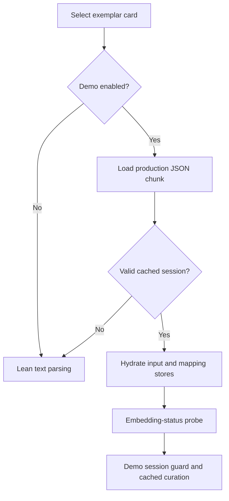

# FM-1 Regulatory Exemplar Integration - Plan

## Goal Capsule

- **Objective:** Users of the mainline application can select the four completed regulatory exemplars and curate their cached demos, while existing examples and deterministic comparisons keep working.
- **Means:** Integrate the recovered regulatory source history and retain the already-landed dependency alignment (KTD1, KTD2).
- **Authority:** The controller's `fm-1` mandate and lane instructions; the chief repository's `docs/plans/2026-10-26-0705-feat-codex-drawdown-campaign-plan.md`, limited to its Goal Capsule and campaign R11, R15, R16, R17, R19 and R20; then this repository's applicable instructions and source plans. Campaign R-IDs are distinct from this plan's local R1–R8.
- **Authority prerequisite:** The chief plan and `ops/drawdown/mandates/_common.md` are absent from this sandbox. Their canonical text has not been read. The controller must supply the scoped excerpts and reconcile this plan with them before build execution. The constraints below come from the supplied lane instructions, not an inferred campaign capsule.
- **Execution profile:** This delivery is a committed plan only. The later build stage uses `lfg` on `drawdown/fm-1`, completing implementation, simplification, review, verification and local commits. Publication belongs to the controller; the campaign gate owns merging (R7).
- **Stop conditions:** Missing source objects or authority excerpts, changed source provenance, failing acceptance gates, or a required action outside R8 block the affected build work. Report controller-fixable environment gaps to the controller. No product decision from Damien is needed for the current exemplar selection.

---

## Product Contract

### Summary

Bring the completed regulatory exemplar branch into the current application without replacing later resolver, search or evaluation fixes. Reuse its cached payloads and strengthen integration coverage around production loading. Record the Python alignment requirement as already delivered when the verified current base still contains it.

### Problem Frame

The checked-out application offers ten exemplars, while four completed regulatory examples remain outside its reachable history. The August handoff's merge and test results predate subsequent dependency and evaluation changes. Integrating from that description alone could omit source tests, restore older dependencies, or mistake historical screenshots for current acceptance evidence.

### Requirements

**Exemplar behavior**

- R1. Integrate the completed phases 4–6 work without losing later mainline behavior. Phase 4 is already present; the remaining source delta is phases 5–6 and their documentation. Source: mandate `fm-1`, `.planning/ROADMAP.md`, source phase plans.
- R2. Preserve all ten existing exemplar identities and add exactly `environmental-compliance`, `energy-utilities`, `securities-regulation` and `data-privacy`. Keep the Securities Enforcement display choice and the source's exact, unique, non-circular forty regulatory leaves. Source: mandate boundary, REG-01–REG-04.
- R3. Each of the fourteen exemplars must support its existing lean workflow and load its own valid cached demo through the current session path. Demo loading must issue no live parsing fallback, pipeline execution or LLM request; the existing embedding-status probe is permitted. Source: DEMO-01–DEMO-05, REGDEMO-01–REGDEMO-03 and the current application behavior.

**Compatibility and evidence**

- R4. Preserve the delivered U10 dependency alignment: `folio-python[search]==0.3.6`, `folio-resolve==0.4.0`, matching lock metadata, and the later deterministic-runner fixes. The requested alignment concerns the `folio-python` package, not a Python interpreter upgrade. Source: mandate `fm-1`, commits `9fb061b1`, `a5bd0512` and `79c323fa`.
- R5. Retain every existing test and assertion, including all six source-branch demo-suite extensions, and add integration coverage where existing tests cannot prove R2–R3. New test failures must not be resolved by skipping cases, lowering expectations or changing historical payload provenance. Source: supplied campaign R15–R16 guardrails.
- R6. Fresh build-stage verification must include the existing frontend and API suites, the regulatory exact-hit gate and production-build Playwright acceptance. Commit actual screenshots under `docs/plans/evidence/` and identify them in the build delivery with `SCREENSHOT: <path>`. Historical source evidence is supporting context only. Source: supplied frontend guardrail and phase acceptance criteria.

**Delivery boundary**

- R7. Keep this planned item on `drawdown/fm-1` and commit locally. Do not add a remote or seek GitHub access; the controller scans, pushes and opens the PR, and the campaign merge gate completes integration onto its current `main`. Source: supplied campaign R15, R17 and R19.
- R8. Do not spend, send messages in the user's voice, change credentials or security settings, force-push, or delete unbacked work. Do not read protected key, environment, secret or credential files. Add no schema migration, data rewrite, package release or outside service. Plans and receipts must use repository-relative paths and public-safe material. Source: supplied campaign R11 and lane hard stops.

### Scope Boundaries

The existing four exemplar areas are fixed for this item. Live demo re-curation, new exemplar areas, new session formats, migration-capture regeneration and dependency upgrades are excluded.

A new diagnostic command, browser framework or deployment mechanism is not needed to integrate this source. One-time installation and browser receipts provide the required evidence; persistent new tooling would need a separate demonstrated requirement.

#### Deferred to Follow-Up Work

- `fm-2`: passwordless LLM-key persistence browser acceptance.
- `fm-3`: declared/locked/installed dependency diagnostic.
- `fm-4`: CI expansion beyond desktop packaging, including broader reproducible-install improvements.
- The source's transactional-demo brainstorm remains future product work; importing its historical document does not authorize implementation.

### Acceptance Examples

- AE1. Covers R2–R3: in a fresh browser context with Demo enabled, selecting Securities Enforcement loads the `securities-regulation` cached session, including visible completed and pending items, without a parse fallback or live model request.
- AE2. Covers R3: a delayed or failed embedding-status response does not prevent a cached demo from becoming usable or permit a live model request during hydration.
- AE3. Covers R4: on the verified starting base, the alignment requirement is satisfied by existing source and installed-package evidence; no redundant dependency downgrade or duplicate patch is introduced.

---

## Planning Contract

### Verified Starting State

Source inspection on 2026-10-26 established the following; no application tests, dependency installation or browser execution ran during planning.

| Subject | Evidence | Consequence |
| --- | --- | --- |
| Item branch | Clean `drawdown/fm-1` at `ae4c480b9e46f843288cc0a16926f486c7261728` | Preserve this history and the plan commit. |
| Local base ref | `main` is `af4a764922fe1f6fb05d47ae27b54d48faaee465`, eleven commits behind the item branch | Do not reset to this stale ref or call it verified remote main. |
| Source refs | Neither requested source branch ref exists; no remote exists | Use verified local source objects and obtain current-base confirmation from the controller. |
| Regulatory source | `b185d009b08d0666307d220dff03579a94684a40` adds phase 5; `cd62f6cb0749168fdf85aba6a64550df4378b9b1` adds phase 6; `700c1c96163e146f7e6a7ae1743e9e9c59520a0b` adds source plans and evidence | These three commits form the remaining integration delta. All 1,484 local snapshots labeled from that feature branch have `700c1c9` as their first parent. |
| Shared ancestor | `e739d74680c7909ba6e6f38562f9d4a07a898323` | The ten-area phase-4 implementation is already common history. |
| Merge simulation | Git-only merge-tree of `ae4c480b` and `700c1c9` returned success and tree `e8e82acd4ae5b6746e1879c0bf37c34e094d040d` | No textual conflicts; resulting backend manifest and lock are identical to current HEAD. This is not runtime evidence. |
| Python alignment | `9fb061b10875d7d01364ba859b19f58da1ead15d` changes the package pin; its manifest and lock are identical to those in squash `a5bd05127d926be8f8b17e252f961cb5074772bf` | PR #9 already includes the requested fix; later PR #10 adds the search extra. |
| Current data and coverage | Ten core exemplars and manifest entries; the source adds all four payloads and extends six suites | Source changes strengthen the suites without removing assertions. |
| Instructions and authority | No repository `AGENTS.md` or `CLAUDE.md` is present in this clone; the handoff's external parent instructions and chief plan are unavailable | Apply supplied lane rules; controller supplies missing applicable authority before execution. |

### Key Technical Decisions

- KTD1. **Integrate the verified regulatory tip onto the current item history.** Retaining source ancestry carries its data, tests and evidence together under R1. Do not merge descendant `d10b321b` or `a6fd7b00`: those belong to the separate resolver-migration line. Confirm source identities and current target base again before integration; named refs may be supplied by the controller without adding a remote in the sandbox.
- KTD2. **Treat the Python alignment as already integrated.** The file comparison in the starting-state table proves the original patch is present, while later commits add required behavior. Preserve the current manifest and lock under R4. Confirm installed distribution versions and non-editable provenance in the verification environment; do not infer runtime state from those files.
- KTD3. **Keep the current lazy loader and session hydration.** `apps/web/src/exemplar/demos/index.ts` uses Vite glob imports because the previous dynamic-import form failed in production. `App.tsx` routes through `loadSessionFromObject`; an unavailable or invalid payload falls back to lean parsing. Production acceptance must catch that fallback under R3 rather than treating a visible Demo chip as success.
- KTD4. **Add narrow integration coverage around the real selection handler.** Existing no-network tests primarily exercise hydration, not the full `App.tsx` selection path. The current handler sets the demo-session flag after awaiting the status probe, so request observation must span that boundary. An observed R3 failure warrants a focused handler/guard correction; this plan does not authorize a general demo refactor.
- KTD5. **Use fresh acceptance evidence and preserve historical inputs.** Keep the source payloads, generators, density report and exact-hit validator. Do not run `scripts/curate_demos.py`, which can call live models, or regenerate `backend/migration/captures/`. Source screenshots do not satisfy R6.
- KTD6. **Use the campaign's authorized execution and delivery route.** Astra remains the selected model for build and review, and controller/gate ownership follows R7. (session-settled: user-directed — chosen over the Sol-first ladder and waiting for individual review: the campaign runs autonomously.)

### Existing Flow to Preserve

The acceptance observer covers selection through the settled mapping screen, including the asynchronous status probe. The fallback in this diagram is existing behavior; reaching it during a known-demo acceptance case fails R3.

### Assumptions and Build Prerequisites

- The controller can supply the campaign Goal Capsule, cited R-IDs and any applicable missing repository instructions. This is an unresolved build prerequisite, not permission for the lane to search for credentials or replace the authority with guesses.
- The controller will confirm its target `main` and source tips against the hashes above. Later movement requires repeating the source comparison and merge analysis while preserving unrelated work.
- Cached dependencies, ontology data and a permitted Playwright/Chromium environment are available to the build stage or can be supplied by the controller. Their availability and installed versions were not tested during planning. Unix-socket failures are environment limitations and cannot count as acceptance passes.
- The exact-hit validator's historical 40/40 result still needs verification against the aligned package and identified ontology snapshot. If it fails, diagnose package/data drift before changing any leaf; the selected regulatory areas remain fixed.

### Risks and System-Wide Impact

The core exemplar list feeds the shared UI, while payload registration and loading live in the web app. Exact agreement across those surfaces matters more than a count-only check. Fresh contexts prevent persisted Demo preferences or cached sessions from hiding a missing area.

The current Docker and desktop packaging paths do not consume the lock in the same way as a frozen verification environment. Record the tested environment; do not claim a new packaged release was verified or alter those pipelines under this item.

The source README's claim of zero runtime API calls exceeds the actual contract, and its exact-hit wording appears to cover more leaves than the regulatory validator checks. Correct those imported descriptions to match R2–R3. The two imported evidence HTML files also contain local-path markers; make those links portable without changing historical results.

---

## Implementation Units

### U1. Integrate the completed source on the verified base

**Goal:** Deliver the missing regulatory data, cached demos and supporting source history while retaining newer behavior.

**Requirements:** R1–R5, R7–R8. **Dependencies:** Authority and source/base prerequisites above.

**Files:** `packages/core/src/exemplar/data.ts`; `apps/web/src/exemplar/demos/index.ts`; the four regulatory `*.demo.json` files under `apps/web/src/exemplar/demos/`; the four matching probe/input pairs and regulatory scripts under `scripts/demos/`; `.planning/phases/05-regulatory-exemplars/`; `.planning/phases/06-demo-payloads-for-regulatory-exemplars/`; source documentation and evidence from `700c1c9`. Inspect `backend/pyproject.toml` and `backend/uv.lock` without creating a redundant change. Retain these source test changes:

- `apps/web/src/exemplar/demos/index.test.ts`
- `apps/web/src/__tests__/demo-mode-smoke.test.ts`
- `apps/web/src/__tests__/demo-mode-no-network.test.tsx`
- `apps/web/src/__tests__/demo-mode-roundtrip.test.tsx`
- `apps/web/src/__tests__/demo-mode-richness.test.ts`
- `apps/web/src/__tests__/demo-mode-excluded-branches.test.ts`

**Approach:** Apply KTD1–KTD3. Reconcile any newly discovered conflicts by preserving current runtime behavior and taking the source's four-area additions. Inspect the complete incoming delta; do not replace the backend with the older branch tree. Keep source historical evidence labeled by its original dates.

**Patterns to follow:** Existing exemplar text arrays, `DEMO_AVAILABLE_SLUGS`, Vite glob loaders, and source test table extensions.

**Test scenarios:**

1. All fourteen registered slugs load valid version-1.3 sessions through the lazy loader and hydration seam.
2. Each source payload retains completed/pending variation, original provider/model metadata, round-trip equality and excluded-branch protections.
3. The existing ten areas remain present and covered by every relevant suite.
4. The source regulatory validator confirms ten exact, unique leaves per area with no ancestor/co-leaf circularity.

**Verification:** The integrated diff contains the intended source delta and no rollback of R4 or current loader/runner fixes. All source-suite extensions remain active; no migration capture changes occur.

### U2. Close the identity and selection-path coverage gaps

**Goal:** Prove that selecting each new example reaches the correct workflow without hidden live work.

**Requirements:** R2–R3, R5; AE1–AE2. **Dependencies:** U1.

**Files:** New `packages/core/src/exemplar/data.test.ts`; strengthen `apps/web/src/exemplar/demos/index.test.ts`; new `apps/web/src/__tests__/regulatory-demo-selection.test.tsx`; existing `apps/web/src/lib/__tests__/llm-config.test.ts`. The relevant behavior is in `apps/web/src/App.tsx`, `apps/web/src/hooks/useSession.ts`, `apps/web/src/lib/llm-config.ts` and `apps/web/src/store/demo-store.ts`.

**Approach:** Follow KTD4. Use the existing Vitest and Testing Library setup, controlled parser/status responses and synthetic provider configuration. Observe requests before selection and isolate state between cases. Change application code only to correct an acceptance failure demonstrated by these integration tests.

**Execution note:** Establish coverage of the real selection/hydration boundary before modifying a handler or guard.

**Test scenarios:**

1. Core ids are unique and exactly the expected fourteen; the four regulatory labels and ten-leaf text structures remain intact.
2. Every core id, manifest id and loadable payload agrees; a missing, duplicate or unexpected identity fails the check.
3. Covers AE1: each regulatory selection loads its own text/tree and mapping state, with no parse fallback or live pipeline/LLM invocation.
4. Covers AE2: delay and fail the status response while keeping the demo usable; forbidden calls remain absent throughout hydration and settlement, including when a synthetic provider is configured.
5. Disable Demo explicitly and select each regulatory area; the controlled parser receives its expected hierarchy and reaches the existing confirmation flow without calling an LLM.
6. Switch between two areas in one session and confirm the second area's state replaces the first, including its demo flag and mapping identity.
7. Retain existing missing/invalid-payload behavior and unknown-slug tests; do not invent a new failure policy to make the happy path pass.

**Verification:** Tests fail for omitted registrations, wrong cached-session identity or an exposed live-call path. Existing test expectations remain at least as strong as before integration.

### U3. Verify the production flow and record current acceptance

**Goal:** Supply evidence that the combined application works in its built form and that R4 remains true in the tested environment.

**Requirements:** R4–R8; AE1–AE3. **Dependencies:** U1–U2.

**Files:** `README.md`; `.planning/ROADMAP.md`; `.planning/STATE.md`; `docs/curating-demo-payloads.md`; `docs/evidence/phases-5-6/pack.html`; `docs/evidence/phases-5-6/pack.artifact.html`; new `docs/plans/evidence/fm-1-integration.md` and screenshots under `docs/plans/evidence/`. Relevant existing backend coverage: `backend/tests/test_folio_resolve_pin.py`, `backend/tests/test_synthetic_runner.py`, `backend/tests/test_search_expansion.py`, `backend/tests/test_pipeline.py`.

**Approach:** Apply KTD2 and KTD5. Use an isolated environment synchronized with the existing lock, record installed distribution versions and editable/non-editable provenance, and identify the ontology snapshot used by the exact-hit gate. Run the verification contract once after the integration changes settle. Use permitted cached Playwright tooling against the production web build; do not add a service or perform a release.

Update only integration-relevant documentation: current milestone state, the actual lazy-manifest registration method, bounded zero-LLM and exact-hit claims, and portable evidence links. Preserve historical receipts and add dated current results separately.

**Browser acceptance scenarios:**

1. From fresh isolated contexts, explicitly enable Demo and load every one of the fourteen areas. Assert the selected area's session identity and visible completed/pending mix.
2. Intercept requests before loading/selecting. Permit application assets and the expected status probe; fail on live parse fallback, pipeline or external model calls. Exercise delayed and failed status responses with no real credentials.
3. Verify the four regulatory lean choices with Demo disabled and controlled parse responses, without running a live mapping pipeline.
4. Capture the fourteen-card input screen and each of the four populated regulatory mapping screens. Confirm images show the expected area and usable layout.

**Evidence targets:** `docs/plans/evidence/fm-1-exemplar-carousel.png`, `docs/plans/evidence/fm-1-environmental-compliance-demo.png`, `docs/plans/evidence/fm-1-energy-utilities-demo.png`, `docs/plans/evidence/fm-1-securities-regulation-demo.png`, `docs/plans/evidence/fm-1-data-privacy-demo.png`. These are proposed build outputs, not files produced during planning.

**Verification:** The receipt identifies the tested commit, commands, outcomes, environment limitations, ontology identity and screenshot paths. It reports no installed sibling editable dependency and makes no claim of deployment or cross-repository U10 comparison without corresponding evidence.

---

## Verification Contract

Run these in the build stage; the plan-stage checks were source/history inspection only. Dependency preparation must respect R8 and use available caches. A missing tool, denied socket or unavailable ontology is an unverified gate to resolve through the controller, not a passing test or a reason to weaken coverage.

| Gate | Entry point | Required evidence |
| --- | --- | --- |
| Source and baseline | Controller-supplied authority/base; local ancestry and merge inspection | Exact source/base hashes; no stale-main reset; R4 already-present finding reconfirmed. |
| Frontend suites | `pnpm test` | All existing package/web suites and U2 additions pass, with no weakened or newly skipped cases. |
| API suites | `pnpm test:api` | Existing API, resolver-adapter and synthetic-runner regressions pass in the recorded environment. |
| Production bundle | `pnpm build` | Successful build containing loadable chunks for all fourteen demos. |
| Regulatory exact-hit gate | `backend/.venv/bin/python scripts/demos/validate_exemplar_hits.py` | Forty of forty leaves pass using identified cached ontology data and the aligned package. |
| Runtime provenance | Installed distribution metadata in the isolated verification environment | `folio-python` 0.3.6 and `folio-resolve` 0.4.0; neither installed from an editable sibling checkout. |
| Browser acceptance | Playwright against the production build | U3 scenarios pass with request interception and committed screenshots. |
| Review and scope | Build-stage simplification/review and controller scan | No unresolved integration defect, prohibited operation or unrelated mandate implementation. |

The imported source's 166-test and 40/40 historical claims are not new results. Preserve `backend/migration/captures/baseline.json`, `candidate.json` and `delta.json`; the existing pin tests depend on their historical meaning. No release command applies to this item.

---

## Definition of Done

- U1 is complete when the verified regulatory source delta is integrated and current dependency/runner behavior is retained.
- U2 is complete when additive tests establish identity parity, correct lean/demo selection and the no-live-call boundary.
- U3 is complete when every required verification gate has a current result and the actual Playwright screenshots are committed.
- Documentation describes verified behavior and clearly distinguishes historical evidence from the new receipt.
- The final diff contains no abandoned experiments or unrelated work; cleanup preserves the backup requirement in R8.
- The lane delivers reviewed local commits on `drawdown/fm-1`, reports any unresolved controller prerequisite, and includes the R6 screenshot paths plus `BRANCH`, `PLAN` and `KIND: planned` markers. The item is not described as landed on main until the controller and campaign merge gate complete R7.
