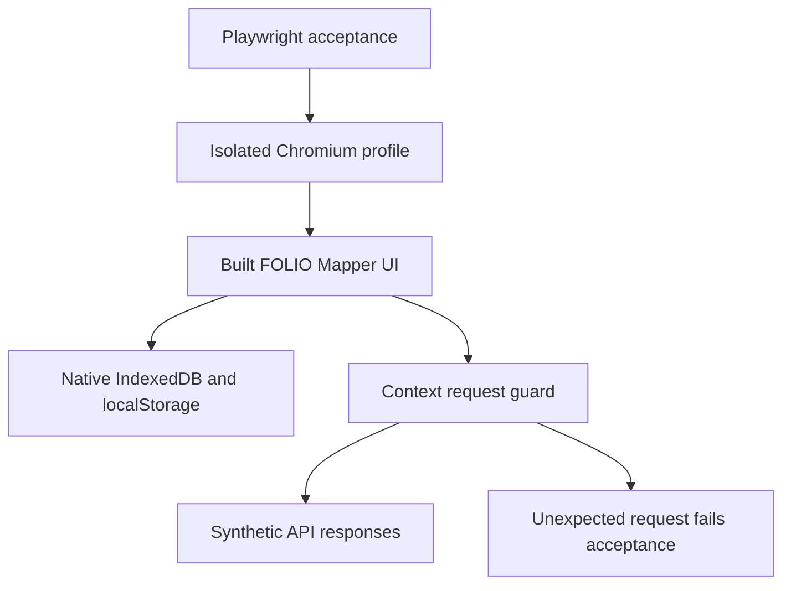
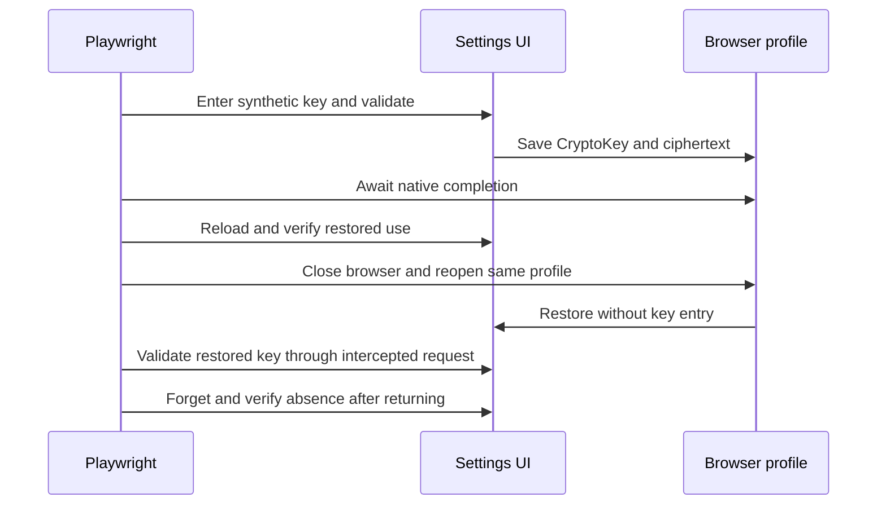

# Passwordless LLM Key Browser Acceptance - Plan

## Goal Capsule

- **Objective:** Users can return to FOLIO Mapper with their saved LLM keys restored without a passphrase, and can reliably forget those keys.
- **Means:** Repeatable Playwright acceptance of the existing application, including a real browser restart (KTD1–KTD3).
- **Authority:** The controller's fm-2 mandate and supplied standing rules govern this item. The chief repo's `docs/plans/2026-10-26-0705-feat-codex-drawdown-campaign-plan.md` remains the campaign authority; its Goal Capsule and cited R11, R15, R16, R17, R19, and R20 were unavailable in this sandbox. Campaign references here derive from the supplied mandate, not an independent reading of that file. The controller must reconcile this plan with those sections before accepting build results.
- **Execution profile:** This stage produces only this plan and its local commit on `drawdown/fm-2`. The separate build stage runs `lfg` against the plan; the controller handles scanning, pushing, and PR creation, and the campaign gate handles merging. Do not add a remote or seek credentials.
- **Stop conditions:** Follow R8–R9. Browser-launch restrictions block browser acceptance evidence, not independent implementation work; they cannot be converted into a passing result. No decision from Damien is needed for the proposed scope.

---

## Product Contract

### Summary

Add browser acceptance for the passwordless key workflow already implemented in the web app. Exercise native browser storage through the real settings UI, isolate provider traffic with synthetic responses, and preserve existing behavior with focused fixes only when acceptance reproduces a defect.

### Problem Frame

The completed `docs/plans/2026-06-13-001-feat-passwordless-llm-key-persistence-plan.md` reports unit/build verification but explicitly leaves the browser walkthrough unverified. Unit tests use fake IndexedDB or mock storage, so they cannot establish persistence across a real browser restart or verify the timing between settings controls, React effects, and browser storage.

### Requirements

These R-IDs are local to fm-2; references prefixed “campaign” identify the separate chief plan.

**Saving and returning**

- R1. A successfully validated provider key auto-saves without a passphrase, and the same key is restored after page reload and browser restart without re-entry. Cover both `Test` and `Save & Close` entry paths.
- R2. Browser persistence retains ciphertext and a nonextractable AES-GCM device key; the general `folio-mapper-llm` state must not retain a usable plaintext API key.
- R3. Failed validation does not persist the rejected value, and successful replacement restores the replacement on the next visit.

**Removal and recovery**

- R4. `Forget` durably removes only its provider's saved credential; `Clear all saved API keys` removes all saved credentials and the device key. A forgotten key must not be silently saved again by pending work or ordinary re-renders.
- R5. Missing device keys, damaged ciphertext, and targeted storage failures leave the affected provider available for manual entry without a passphrase, an unhandled application error, or a false saved indication.
- R6. Existing legacy-canary cleanup runs once, permits re-entry, and does not erase a subsequently saved device-key credential on later reloads.

**Compatibility and delivery**

- R7. Saved keys preserve the existing environment/keychain/browser priority and demo-mode prohibition on live LLM execution. A restored key need not become connection-valid until the existing validation action succeeds.
- R8. Acceptance uses only synthetic keys and isolated test profiles, with unexpected application API or external requests failing the test. No real credentials, spend, sends, security-setting changes, or unbacked deletion are permitted (campaign R11 and the supplied hard stops).
- R9. Preserve every existing test and the current exemplar; keep fm-2 on its own branch and produce committed Playwright screenshots plus truthful verification evidence. No schema migration, production data rewrite, package release, new external service, or unrelated mandate work is included (campaign R15–R17, R19–R20).

R1–R7 retain the June passwordless plan's acceptance contract and the device-key choice in `docs/brainstorms/2026-06-09-passwordless-llm-key-persistence-brainstorm.md`. R8–R9 apply the controller's campaign constraints.

### Scope Boundaries

In scope: the browser harness, acceptance cases, evidence, and the smallest application corrections needed to satisfy R1–R7 after a browser failure demonstrates the gap. Preserve the existing session-only in-memory key after Forget; removal concerns persistence. A newly entered and successfully validated replacement must still be saveable.

Considered and not built:

- A new vault design or settings redesign: the existing device-key contract is settled; only reproduced acceptance failures justify local corrections.
- A full browser/platform matrix, Electron packaging acceptance, actual provider authentication, private-mode certification, and adversarial storage-fuzzing: this item establishes Chromium browser acceptance and a labeled desktop-bridge simulation. Expand only if the selected runtime cannot exercise the existing contract.
- Crash durability at the instant the settings panel closes: closure is not currently a storage acknowledgment. R1 measures persistence after native completion; a false saved indication remains a defect under R5.
- Cross-tab synchronization and arbitrary corrupt metadata repair: these would introduce separate behavior beyond the requested browser acceptance.

#### Deferred to Follow-Up Work

- fm-1 owns exemplar-branch and Python-alignment integration.
- fm-3 owns dependency-version diagnostics.
- fm-4 owns CI extension. This item supplies a standalone browser command that later CI work can consume.

---

## Planning Contract

### Verified Starting State

Source inspection on 2026-10-26 found a clean `drawdown/fm-2` at `ae4c480b9e46f843288cc0a16926f486c7261728`, with no remote. Local `main` is the older `af4a764922fe1f6fb05d47ae27b54d48faaee465`; it is not evidence of the live upstream head. Keep the assigned branch and leave base integration to the controller.

| Existing surface | Evidence and implication |
|---|---|
| Passwordless implementation | Commits `c10ec4c1` and `402aff3f` are present; `device-key.ts`, `key-vault.ts`, `useKeyResolution.ts`, and `App.tsx` already implement the feature. |
| Browser harness | No tracked Playwright configuration, browser specs, or Playwright dependency exists. |
| Workspace test discovery | Root scripts run package Vitest suites and the web suite. `apps/web/vitest.config.ts` uses broad default discovery; put browser specs outside these workspace roots. |
| Saved-key restoration | `llm-store.ts` persists an empty API key and untested status; `useKeyResolution` restores the key and saved source without marking the connection valid. |
| Forget behavior | `App.tsx` retains the valid in-memory key, sets `rememberKey` false, and changes its source to manual. The auto-save effect does not check that preference: this is a credible, unverified re-save defect. |
| Save completion | `LLMSettings.tsx` closes after validation without awaiting encryption. `device-key.ts` resolves request results before transaction completion; browser tests must distinguish these events. |

The mandated handoff and `.planning/ROADMAP.md` were read. Their historical test counts and integration claims are not current verification. No tests, builds, installations, or browsers ran during planning. No repository `AGENTS.md` or `CLAUDE.md` was present; the controller-supplied instructions apply.

### Key Technical Decisions

- KTD1. **Test the built application with native browser storage.** Add root Playwright Test tooling and `tests/browser`, leaving Vitest discovery and existing tests intact (R1–R9). Serve a fresh web build on one fixed loopback origin, with a strict port and no reuse of an existing server. No Python backend is required because browser API boundaries are intercepted.
- KTD2. **Use a distinct persistent Chromium profile per test and retry.** Close the first persistent context completely, then relaunch the same profile and origin inside the same test (R1, R4). Do not seed storage between launches. Playwright's JSON storage-state support does not document a guarantee for nonextractable CryptoKey restoration, so it is not the restart proof. [Persistent-context API](https://playwright.dev/docs/api/class-browsertype#browser-type-launch-persistent-context), [storage-state API](https://playwright.dev/docs/api/class-browsercontext#browser-context-storage-state).
- KTD3. **Intercept before navigation on every browser launch.** Block service workers, fulfill only explicitly recognized API method/path/provider combinations, allow only local frontend assets, and abort/report every unexpected application request (R8). Inspect synthetic authorization in memory and record booleans or counts, never header dumps. [Playwright network interception](https://playwright.dev/docs/network).
- KTD4. **Use observable persistence and hydration checkpoints.** Await the saved indication and native storage transaction completion before ordinary reload/restart; after restoration, use the existing `Test` action to prove the recovered value reaches the synthetic API (R1–R3, R7). Use retrying assertions and accessible names or existing placeholders, without fixed sleeps or application-store injection. [Playwright assertions](https://playwright.dev/docs/test-assertions), [IndexedDB transaction lifecycle](https://www.w3.org/TR/IndexedDB/#transaction-lifecycle).
- KTD5. **Reproduce before repairing.** Keep failing acceptance expectations aligned with R1–R7, then make minimal fixes in the owning application code. Likely sites are the auto-save effect, clear handlers, resolver error boundaries, and IndexedDB transaction completion. Preserve session-only use, re-entry, desktop priority, and the existing encryption format.
- KTD6. **Use synthetic, reviewable evidence.** Commit only selected masked screenshots and a short receipt under `docs/plans/evidence/fm-2/`; keep profiles, traces, raw browser reports, and storage dumps out of git (R8–R9). Retain a verified test-state backup before destructive fault injection or profile cleanup; never operate on a personal browser profile.

### Assumptions and Execution-Time Unknowns

- Chromium is the proposed acceptance target; this is an agent-selected coverage boundary, not a claim about other engines. Lock a compatible Playwright dev dependency and matching browser binary during the build stage, using the supplied dependency caches.
- Native browser launch and loopback serving remain unverified in the socket-restricted sandbox. If they fail, retain the runnable suite and sanitized failure evidence for a controller-provided authorized runtime; do not weaken browser isolation or claim browser acceptance passed.
- The chief campaign authority is absent as recorded in the Goal Capsule. The supplied rules are sufficient to draft this bounded plan; the controller owns the remaining authority reconciliation.
- Timing defects are hypotheses. Only runtime evidence determines whether KTD5 requires application changes; successful existing behavior should receive tests without refactoring.

### High-Level Technical Design

The harness boundary keeps production UI, storage, and cryptography real while replacing provider/network responses (KTD1–KTD3).

The persistence proof crosses document and process lifetimes without reseeding (KTD2, KTD4).

### System-Wide Impact

Settings callbacks and the App auto-save effect share responsibility for persistence; a fix to forgetting must also prevent stale asynchronous saves from restoring a removed value. Browser storage remains origin-bound, and its record names and ciphertext envelope remain unchanged. A nonextractable CryptoKey prevents raw export; it does not prevent same-origin scripts from decrypting or establish protection from local profile access. [WebCrypto security considerations](https://www.w3.org/TR/WebCryptoAPI/#security-considerations).

The browser suite validates frontend behavior against mocked API contracts, not backend or real-provider authentication. A desktop preload stub checks the resolver boundary only. Existing Vitest and API tests remain independent regression evidence.

---

## Implementation Units

### U1. Add the isolated browser harness

**Goal:** Run the real web application with native storage and deterministic synthetic API responses.

**Requirements:** R8–R9; supports R1–R7. **Dependencies:** None.

**Files:** Add `playwright.config.ts`, `tests/browser/fixtures/offline-api.ts`, `tests/browser/helpers/key-vault.ts`, and `tests/browser/passwordless-key-persistence.spec.ts`; update root `package.json`, `pnpm-lock.yaml`, and `.gitignore`.

**Approach:** Apply KTD1–KTD3 and KTD6. Add a root `test:browser` entry that builds the web application and runs the dedicated suite. Keep existing `test` and `test:api` behavior unchanged. Ignore generated browser output and test profiles without ignoring committed evidence.

The API fixture must use the current schemas in `packages/core/src/llm/api-client.ts`, `packages/core/src/embedding/api-client.ts`, and the matching backend routers as references. Startup needs known-models, key-status, embedding warmup/status, and OWL-update status responses. Settings adds pricing, models, test-connection, and failure-path probe-models responses. Explicitly reject unknown `/api` requests rather than forwarding them to a local backend. Settings may refresh models more than once; avoid brittle global request counts.

**Patterns to follow:** Existing API client response shapes; `Header.tsx`'s `LLM settings` accessible name; `ProviderCard.tsx`'s provider-specific key placeholders. Do not assume settings has a dialog role. Add minimal accessible labeling only if reliable scoping requires it.

**Test scenarios:**

1. A fresh synthetic profile opens the actual input page and LLM settings with the expected startup fixtures and no unexpected requests.
2. A deliberate unexpected API or external request is blocked and appears in the fixture's failure ledger; teardown asserts the ledger is empty for ordinary cases.
3. A second isolated case starts without another case's saved keys; each retry uses a different profile.

**Verification:** The harness smoke case passes against a newly built app, without a backend, real keys, or external application traffic. Existing Vitest suites still discover their original tests.

### U2. Prove save, restore, replacement, and durable forgetting

**Goal:** Demonstrate R1–R4 across UI actions, page reload, and browser process restart.

**Requirements:** R1–R4, R7–R9. **Dependencies:** U1.

**Files:** Extend `tests/browser/passwordless-key-persistence.spec.ts` and the native-storage helper. Conditional fixes: `apps/web/src/App.tsx`, `apps/web/src/store/llm-store.ts`, `packages/ui/src/components/settings/LLMSettings.tsx`, `packages/ui/src/components/settings/ProviderCard.tsx`, `packages/core/src/llm/device-key.ts`, and additive tests in `packages/core/src/llm/device-key.test.ts` when that helper changes.

**Approach:** Apply KTD4–KTD5. Reproduce the Forget hypothesis early. If confirmed, honor deliberate opt-out and reject stale save completions while allowing a newly entered, validated key to save again. Do not turn restored keys automatically valid to make tests pass.

**Patterns to follow:** `persistKeyToVault` and clear handlers in `App.tsx`; `llm-store.ts` partialization; the IndexedDB helpers and current core tests. Observe the stored CryptoKey in the browser realm and return only metadata/booleans.

**Test scenarios:**

1. Typing an unvalidated key leaves no vault entry; rejected validation leaves that value unsaved.
2. Successful `Test` auto-saves, shows `Key saved`/`Encrypted`, and never presents a passphrase prompt. Separately, `Save & Close` followed by reopening settings reaches the same saved checkpoint.
3. The native record is an AES-GCM 256-bit, nonextractable secret CryptoKey with the expected usages; raw export fails. The vault envelope contains ciphertext; localStorage/sessionStorage snapshots and observed localStorage writes contain no synthetic plaintext key, and `folio-mapper-llm` retains an empty API key.
4. Actual page reload restores the saved key without entry. Complete a separate close/relaunch of the same profile and validate the restored value through the intercepted API. Wait for positive hydration before asserting absence of passphrase UI.
5. Replacing a saved key resets validation; a rejected replacement is not saved. A successful replacement becomes the restored value after reload.
6. Save two providers, forget one, perform an ordinary subsequent UI action, and reload: the forgotten provider is absent and the other is restored. Clear all, verify the device-key record is removed, then reload/relaunch and verify no saved key returns.
7. After Forget, the existing in-memory value may remain session-only; entering and validating a new key restores normal persistence. If a stale-save race is reproduced, add a deterministic delayed-completion regression without substituting fake crypto for the normal persistence path.

**Verification:** All assertions pass without reseeding restoration state. A correction is accepted only with its regression case retained and relevant existing tests passing.

### U3. Cover recovery, resolver priority, and demo safety

**Goal:** Demonstrate existing recovery and compatibility behavior with a saved key present.

**Requirements:** R5–R9; preserves R1–R4. **Dependencies:** U1–U2.

**Files:** Add `tests/browser/passwordless-key-recovery.spec.ts` and `tests/browser/passwordless-key-compatibility.spec.ts`; extend fixture/helpers. Conditional fixes: `apps/web/src/hooks/useKeyResolution.ts`, `apps/web/src/App.tsx`, `packages/core/src/llm/key-vault.ts`, `packages/core/src/llm/device-key.ts`, plus additive regression cases in their existing core tests.

**Approach:** Use KTD3–KTD6. Seed legacy fixtures once before application initialization, not on every navigation. Inject faults narrowly at the device-key database operation or the encrypted-vault write; do not break unrelated Zustand/session storage to simulate a vault failure. Restore the affected boundary before proving re-entry.

**Patterns to follow:** Browser database `folio-mapper-keyvault`, store `device-key`, record `aesKey`; localStorage `folio-mapper-vault-<provider>`, `folio-mapper-vault-meta`, and `folio-mapper-vault-canary`. Use existing demo assets and `apps/web/src/lib/llm-config.ts` as the compatibility contract.

**Test scenarios:**

1. Remove only the device-key record from a backed-up synthetic fixture while retaining ciphertext, then reload: the affected key does not restore, the app remains usable, and re-entry/validation survives another reload. Do not assert the database remains absent: the resolver may generate a replacement key before decryption fails.
2. Tamper with a decoded ciphertext byte and re-encode it; separately leave metadata pointing at a missing payload. Both cases permit manual recovery without a passphrase or false saved claim.
3. Reject the device-key database open during saving; separately reject the exact vault payload write. The session key still validates, the UI remains usable, no saved credential appears after reload, and no unhandled page error occurs. Account for narrowly expected caught console errors without suppressing other failures.
4. Seed a synthetic legacy canary and legacy payloads. First load clears them and shows the existing re-entry notice; subsequent reload does not repeat cleanup or the notice. A newly entered key then persists normally.
5. With a real browser-created saved fixture, an environment-provider status takes precedence over the vault. A preload-shaped desktop stub with a distinct synthetic keychain value similarly wins over the browser value and bypasses browser-vault use; label this simulated boundary coverage.
6. Restore and revalidate a saved key, reset the phase-specific request ledger, enable Demo, and select an existing exemplar. Exercise a reachable LLM-capable interaction such as candidate fallback/manual search: it must complete using fixture/symbolic behavior with no live LLM execution. Any allowed mapping request must omit LLM configuration according to the existing API contract. Startup catalog/pricing/status traffic is distinct from inference traffic.

**Verification:** Recovery succeeds after each fault is removed; compatibility tests do not pass merely because the active key was untested. All existing demo and key-vault tests retain their assertions.

### U4. Record browser evidence and the repeatable run

**Goal:** Give the controller reproducible acceptance results and screenshots for the reviewed revision.

**Requirements:** R8–R9. **Dependencies:** U1–U3.

**Files:** Update the testing section of `README.md`; add `docs/plans/evidence/fm-2/acceptance.md`, `docs/plans/evidence/fm-2/passwordless-key-restored.png`, and `docs/plans/evidence/fm-2/passwordless-keys-forgotten.png`.

**Approach:** Apply KTD6. Capture screenshots from passing Playwright checkpoints with key fields masked. Record the tested source revision, commands actually run, browser/package versions, each scenario's outcome, the real restart sequence, and the synthetic-network boundary. Distinguish desktop-stub coverage from Electron acceptance and unavailable runtime evidence from product failures.

**Test expectation:** No separate behavior is introduced; U1–U3 supply the executable verification. Inspect the screenshots and receipt for legibility, correspondence to assertions, and absence of private data.

**Verification:** The documented browser command works from the stated prerequisites, every claimed result has an actual run, and the selected evidence is committed. The build-stage final response names a committed path as `SCREENSHOT: docs/plans/evidence/fm-2/passwordless-key-restored.png` only after capture succeeds.

---

## Verification Contract

All commands below belong to the build stage. Re-check the starting revision and available runtimes first; planning did not establish a green baseline.

| Check | Applicability | Required evidence |
|---|---|---|
| `pnpm test` | Before and after implementation | Existing package/web Vitest suites remain intact and pass; separately identify any pre-existing failure. |
| `pnpm build` | Before and after implementation | Web production build succeeds. |
| `pnpm test:browser` | Added by U1 | U1–U3 pass in native Chromium with a fresh build; no unexpected application traffic. |
| Native restart and storage checks | U2–U3 | Same-profile close/relaunch, exact synthetic restored use, native CryptoKey metadata, and durable forgetting; no replacement with storage-state import. |
| `pnpm test:api` | Final regression when the supplied Python environment is available | Report actual pass/fail or a concrete environment blocker; do not repair dependency drift or CI under fm-2. |
| Evidence inspection | U4 and any frontend correction | Committed screenshots show the actual passing checkpoints; receipt contains no credentials, raw profiles, or machine-local paths. |

A browser launch failure such as the sandbox's expected stream/socket error is an infrastructure limitation, not an accepted substitute for Playwright results. Complete independent work and let the controller arrange an authorized run. Preserve existing failures and test assertions; do not hide them with skips, broader mocks, retries that conceal defects, or reduced coverage.

---

## Definition of Done

- U1–U4 satisfy R1–R9, with every acceptance case run or explicitly reported as blocked; blocked required browser cases mean acceptance remains incomplete.
- Confirmed defects have the smallest scoped correction and a retained regression test; unused experimental additions are absent from the final diff.
- Existing tests and exemplar data are preserved, and validation outcomes distinguish current evidence from historical claims.
- The controller has the local branch, this plan, the browser command, and the committed evidence for publication and the campaign merge gate.
- No schema migration, production data rewrite, new outside service, package release, or Damien-only decision is required by this plan.
