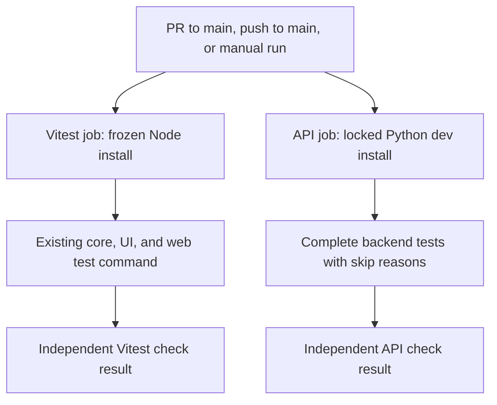

# fm-4 Vitest and API CI - Plan

## Goal Capsule

- **Objective:** Maintainers can see whether proposed changes pass the existing frontend and API tests before merging them.
- **Means:** Add independent GitHub Actions test checks using the existing suite entry points (KTD1, KTD2).
- **Authority:** The supplied fm-4 mandate and lane rules govern this item. The chief repository's `docs/plans/2026-10-26-0705-feat-codex-drawdown-campaign-plan.md`, specifically its Goal Capsule and campaign R11, R15, R16, R17, R19, and R20, remains the upstream authority. Repository instructions and applicable plans govern implementation details.
- **Source access limitation:** The chief plan and `ops/drawdown/mandates/_common.md` are absent from the supplied sandbox. Their contents were not independently verified; campaign references below refer to the rules supplied with the mandate. The controller must supply or check the named sections before scheduling the build. This needs no product decision from Damien.
- **Execution boundary:** This stage produces and locally commits the plan only. The build stage implements fm-4 on `drawdown/fm-4`, with clean-install smoke verification before claiming suite coverage.
- **Delivery:** The sandbox worker commits locally. The controller scans, pushes, opens the PR, and supplies hosted-check evidence; the campaign gate owns merging (campaign R15, R19).
- **Stop conditions:** Preserve the lane's hard stops (R5). Report a failure that requires work outside fm-4 without weakening tests or silently widening scope.

---

## Product Contract

### Summary

Run the existing Vitest and Python API suites in ordinary CI. Supply the missing development dependency needed for clean API test collection, and document how to reproduce the checks.

### Problem Frame

At the recorded baseline, the only workflow is `.github/workflows/build-desktop.yml`. It runs on manual dispatch and release tags, builds installers, and does not execute either test suite. Successful packaging therefore gives maintainers no automatic evidence that the tested application behavior still works.

The August handoff describes an older dependency state. Static inspection of the current manifests, lockfile, test fixtures, and scripts establishes this plan's starting point; no tests, builds, or dependency installs were run during planning.

### Requirements

**Coverage**

- R1. CI must execute the existing frontend suites in `packages/core`, `packages/ui`, and `apps/web` through their established root entry point.
- R2. CI must execute the complete `backend/tests/` suite, retaining existing assertions and intentional optional-dependency skips.
- R3. Test and dependency-install failures must remain visible as failed checks; an unexecuted or skipped test must not be represented as a pass.

**Preservation and delivery**

- R4. Preserve existing application behavior, regulatory exemplars, desktop packaging, test coverage, and migration fixtures; work only fm-4.
- R5. Honor the supplied lane guardrails: no secret or credential access, spending, security-setting changes, sends in Damien's voice, destructive deletion, force-push, schema migration, data rewrite, package release, or new outside service. Never add a remote or seek a login in this sandbox (campaign R11, R15, R16).
- R6. Keep the plan and implementation on `drawdown/fm-4`, use public-safe repository-relative paths in committed material, and leave publication and merging to the controller and campaign gate (campaign R17, R19).

### Key Decisions

- **Deliver the assigned hygiene item.** Governs R4. (session-settled: user-directed — chosen over speculative features: durable maintenance is the campaign's next work when planned work and worthwhile expansions run out.)
- **No dependency on Damien's time through 2026-10-30.** Governs R5, R6. (session-settled: user-directed — chosen over waiting for review: the controller and campaign gate handle routine delivery.)

The campaign's expansion-merge policy remains settled; fm-4 does not introduce an expansion or invoke a new review hold.

### Scope Boundaries

Expected implementation touches are one test workflow, backend development dependency metadata and its lock, focused testing documentation, and a verification receipt. No frontend source change is planned, so a Playwright screenshot is not applicable. Any necessary frontend change would require the lane's committed screenshot evidence and an explicit scope assessment under R4.

Considered and not included:

- A Python/Node/OS matrix, mandatory FAISS or spaCy-model installation, and model downloads: the existing base-suite contract can be exercised on one Linux lane. Reconsider only if actual failures establish a supported-platform requirement.
- Custom caching, an aggregate status gate, coverage thresholds, and a test-report publishing service: native job logs and independent check results provide the required evidence. Reconsider after measured runtime or reporting deficiencies.
- Changing branch protection, enabling a merge queue, and editing desktop release actions: these are separate operational changes. A campaign merge gate does not establish that GitHub merge queues are enabled.

#### Deferred to Follow-Up Work

Mandate items fm-1 through fm-3 remain outside this branch. Dependency-drift diagnostics, passwordless-key browser acceptance, exemplar integration, and the exemplar product choice belong to their respective items. Do not use fm-4 to regenerate migration captures or upgrade runtime dependencies.

---

## Planning Contract

### Verified Starting State

The branch was clean at `ae4c480b9e46f843288cc0a16926f486c7261728`. No repository or ancestor `AGENTS.md`/`CLAUDE.md` file was found in the supplied filesystem; the instructions supplied in the task remain applicable.

| Evidence | Current fact | Planning consequence |
| --- | --- | --- |
| `.github/workflows/build-desktop.yml` | Only workflow; manual and `v*` tag triggers | Add a separate workflow; preserve release behavior |
| `package.json` and workspace manifests | Root `test` runs package suites, then web; scripts use Vitest run mode | Reuse the root command, with no new test runner configuration |
| `backend/pyproject.toml` | Python >=3.11; `dev` is an optional extra | Select the dev extra explicitly during installation |
| `backend/tests/test_embedding.py` | Imports NumPy before any optional skip | Add NumPy to development dependencies before clean-suite acceptance |
| `backend/pyproject.toml`, `backend/uv.lock` | Matching `folio-python==0.3.6` and `folio-resolve==0.4.0`; NumPy is currently embedding-only | Preserve FOLIO pins and refresh only necessary lock metadata |
| `backend/tests/conftest.py` and API fixtures | Existing test configuration and mocked clients avoid starting production lifespan | Run pytest directly; do not start the API server |
| `backend/tests/test_folio_resolve_pin.py`, `backend/migration/captures/` | Committed anti-refork and golden fixtures exist | Use a complete checkout; preserve captures byte-for-byte |

The test clients and mocks indicate that the base suite needs no provider credentials or running services. This is a static finding, not proof of a passing or entirely offline run. Production lifespan does perform background initialization; starting it is not part of this test workflow.

### Assumptions

- The proposed trigger scope is pull requests targeting `main`, pushes to `main`, and manual dispatch. Scheduled runs and other branch targets were not requested.
- One Linux job per suite, with the existing optional skips, is the appropriate initial CI coverage. This does not establish support for every optional integration.
- Hosted runner availability and actual PR/main event behavior must be verified by the controller after publication; this clone cannot establish them.

### Key Technical Decisions

- KTD1. **Use two independent jobs in `.github/workflows/ci.yml`.** Give Vitest and API tests stable, distinct check names, with no dependency between jobs, path filters, or conditions that suppress test execution. A failure in one job must not cancel the other. Preserve the root JavaScript command's existing fail-fast behavior within that job. Governs R1-R3. [GitHub status-check guidance](https://docs.github.com/en/pull-requests/how-tos/merge-and-close-pull-requests/troubleshooting-required-status-checks).
- KTD2. **Install from the committed locks in clean environments.** Use Node 22 with an explicitly pinned pnpm 10 release, and Python 3.12 with an explicitly pinned uv release. Perform frozen pnpm installation and locked uv synchronization with the `dev` extra. Run pytest through the prepared backend virtual environment; installing the backend itself as editable is acceptable, while editable sibling libraries are not. Governs R1-R3. [pnpm 10 install semantics](https://pnpm.io/10.x/cli/install), [uv extra and lock semantics](https://docs.astral.sh/uv/concepts/projects/sync/).
- KTD3. **Declare NumPy as a test prerequisite.** Add the existing `numpy>=1.26,<3.0` constraint to the backend `dev` extra, retaining its embedding declaration. Refresh the lock without unrelated upgrades. Do not select all extras or change optional tests to conceal collection errors. Governs R2, R4.
- KTD4. **Use current compatible actions without changing application dependency versions.** Resolve immutable action release references and concrete pnpm/uv executable pins during implementation, recording their versions in the receipt. Node 22 is a conservative supported choice for the existing Vite 6/Vitest 2 stack; Python 3.12 matches desktop packaging. Action-internal Node runtimes are distinct from the application runtime. Governs R4. [Node release status](https://nodejs.org/en/about/previous-releases), [Vite 6 requirements](https://v6.vite.dev/guide/), [Vitest 2 requirements](https://v2.vitest.dev/guide/), [GitHub action-runtime change](https://github.blog/changelog/2026-09-23-node-20-is-no-longer-available-in-github-actions/).
- KTD5. **Keep the new workflow bounded and read-only.** Use `contents: read`, normal PR events, a finite 20-minute timeout per job, and concurrency scoped to workflow, event, and ref so a newer PR revision can replace its obsolete run. Do not inherit release permissions, use `pull_request_target`, publish artifacts to a service, or configure secrets. Disable automatic setup-action caches for the initial cold-install lane. Governs R3-R5. [GitHub workflow syntax](https://docs.github.com/en/actions/reference/workflows-and-actions/workflow-syntax).
- KTD6. **Use Astra for campaign work.** Governs R6. (session-settled: user-directed — chosen over the Sol-first ladder: the campaign fixes the execution model.)

No architecture bake-off is needed: extending the existing GitHub Actions setup with ordinary suite checks is reversible and does not create a new data format or public interface.

### High-Level Technical Design

The desktop workflow remains a separate dispatch/tag path under R4. Successful Vitest execution covers all three suites; an earlier package failure can prevent later JavaScript suites from running, while the API job continues independently.

### Risks and Deferred Execution Details

Clean installation may reveal failures hidden by a local environment. Investigate and record them; never use unlocked installation, added skips, test deletion, or golden regeneration to manufacture success. A runtime fix outside the CI setup requires a separate scope decision by the controller under R4.

Exact tool pins, elapsed times, current test counts, and unexpected network activity are execution-time findings. If a cold run exceeds the initial timeout, record the cause before adjusting the bound. If the controller confirms an actual GitHub merge queue, add its `checks_requested` event before making these checks queue prerequisites; no queue setting changes belong here. [GitHub event semantics](https://docs.github.com/en/actions/reference/workflows-and-actions/events-that-trigger-workflows).

---

## Implementation Units

### U1. Make the locked development environment collect the API suite

**Goal:** Remove the proven clean-install NumPy gap without expanding runtime dependencies.

**Requirements:** R2-R4; KTD2, KTD3.

**Dependencies:** None after the controller resolves the Goal Capsule's source-access prerequisite.

**Files:** Modify `backend/pyproject.toml` and `backend/uv.lock`. Exercise existing `backend/tests/test_embedding.py`, `backend/tests/test_nlp.py`, `backend/tests/test_search_expansion.py`, and `backend/tests/test_folio_resolve_pin.py` within the full suite.

**Approach:** Apply KTD3 to the existing dev-extra pattern and inspect the resulting lock diff for unintended package changes. Keep the current FOLIO versions and committed fixtures unchanged.

**Execution note:** This is dependency configuration; clean-install and collection proof is more useful than a test that mirrors the manifest.

**Test scenarios:**

1. A fresh Python 3.12 environment synchronized with the dev extra collects the full test directory without a NumPy import error.
2. Without optional FAISS or spaCy models, only existing conditional skips apply and their reasons are visible.
3. A dependency change that actually requires re-resolution is rejected by locked installation in an isolated copy; an ordinary install leaves the committed lock unchanged.

**Verification:** Full-suite results and lock review establish R2 and R4. No new test file is required because this unit changes dependency metadata only.

### U2. Add independent frontend and API CI checks

**Goal:** Surface suite failures on the proposed PR/main trigger scope.

**Requirements:** R1-R6; KTD1, KTD2, KTD4-KTD6.

**Dependencies:** U1 for the API installation contract.

**Files:** Create `.github/workflows/ci.yml`. Existing coverage lives in `packages/core/src/**/*.test.ts`, `packages/ui/src/**/*.test.{ts,tsx}`, `apps/web/src/**/*.test.{ts,tsx}`, and `backend/tests/test_*.py`. Treat `.github/workflows/build-desktop.yml` as an unchanged reference.

**Approach:** Wire the existing entry points into the two jobs using KTD1-KTD5. Use the repository root for pnpm and `backend` for Python. Recheck supported action releases when choosing pins, without copying historical action versions blindly.

**Patterns to follow:** Existing setup-step layout in the desktop workflow; current root and workspace test scripts; backend pytest fixtures.

**Test scenarios:**

1. A cold checkout installs both lockfiles successfully, and the successful path runs all three Vitest suites and the complete API suite.
2. A failed install or test command exits nonzero without error suppression; the independent job still has a runnable path. Do not claim later JavaScript suites ran after fail-fast termination.
3. A stale dependency declaration requiring resolution fails its install step without rewriting the lock.
4. Workflow validation confirms PR/main/manual triggers, distinct check names, read-only permissions, concurrency isolation, and bounded jobs. Desktop workflow content remains unchanged.

**Verification:** Validate the workflow with actionlint and run both exact suite entry points in the build environment. Hosted trigger and check-result verification belongs to the controller. No YAML-mirroring unit tests or browser screenshots are needed for this configuration-only change.

### U3. Document reproduction and record acceptance evidence

**Goal:** Let contributors reproduce CI and let the controller distinguish local results from hosted acceptance.

**Requirements:** R1-R6; KTD2, KTD6.

**Dependencies:** U1, U2.

**Files:** Update the testing/setup portions of `README.md`; create `docs/plans/evidence/fm-4-ci-verification.md` after build-stage verification.

**Approach:** Explain the dev-extra setup, locked installs, existing test entry points, and optional skips. Record tested commit, tool versions, actual commands, suite results, skip reasons, and workflow validation in the receipt. Use repository-relative paths and concise sanitized summaries. Leave hosted checks explicitly pending until the controller supplies real run evidence.

**Test expectation:** No new automated test; documentation and an evidence receipt introduce no runtime behavior.

**Verification:** Documented commands match the workflow and actual execution. The receipt does not recycle historical pass counts or label unexecuted checks as passing.

---

## Verification Contract

These checks belong to the build stage. Planning establishes source facts only and makes no green-suite claim.

| Check | Entry point or evidence | Expected result |
| --- | --- | --- |
| Node installation | `pnpm install --frozen-lockfile` at repository root | Clean install, no lock rewrite |
| Frontend coverage | `pnpm test` at repository root | Core, UI, and web execute on success; nonzero on failure |
| Python installation | `uv sync --locked --extra dev` in `backend` | Complete development environment, including NumPy |
| API coverage | `.venv/bin/python -m pytest tests/ -v -ra` in `backend` | Complete suite executed; actual passes and existing skips reported |
| Workflow contract | actionlint against `.github/workflows/ci.yml`, plus trigger/job inspection | Valid syntax and expressions; no hidden failures or release steps |
| Failure semantics | Locked-install rejection in an isolated copy and concrete command-exit evidence | Invalid resolution and suite failures cannot produce green checks |
| Scope preservation | Compare tests, application code, FOLIO pins, migration captures, and desktop workflow against the build baseline | No unintended changes or weakened coverage |
| Hosted acceptance | Controller's first PR run and post-merge main run | Both checks attach to the intended revision and finish successfully |

Establish the build's current baseline before changing metadata. Use an environment without warmed application/model caches for clean-install proof. Optional-test reasons must come from execution, not estimated counts. Preserve original files when constructing any isolated negative check.

The controller should inspect first-PR behavior directly: manual dispatch normally requires the workflow to exist on the default branch. Remote results remain unverified in this sandbox. No release or deployment validation is applicable because this item changes neither path.

---

## Definition of Done

The plan-stage deliverable is this reviewed document committed locally on `drawdown/fm-4`, with no implementation or test execution.

The build-stage local handoff is complete when U1-U3 meet their verification criteria, both suites pass with only their established optional skips, workflow validation succeeds, and the receipt distinguishes executed checks from pending hosted checks. The diff contains only the intended implementation artifacts; no abandoned experiments or unrelated edits are included.

Campaign completion additionally requires the controller's verified PR and main runs, publication, and merge through the existing campaign gate. Source access and hosted evidence remain controller responsibilities; no new decision from Damien is identified.
