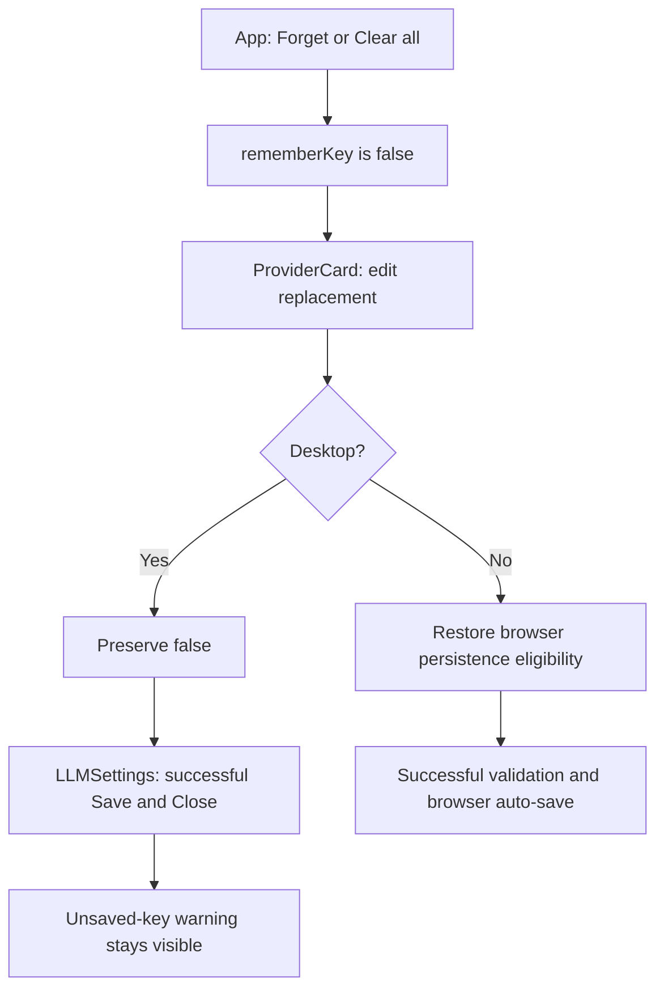

# FM-5 Desktop Unsaved-Key Warning Repair - Plan

## Goal Capsule

- **Objective:** Desktop users who replace a forgotten or cleared API key receive the existing warning before closing settings with that key unsaved.
- **Means:** Restrict the key-edit persistence reset to browsers and prove the desktop flow through the existing settings UI (KTD1–KTD3).
- **Authority:** The controller's `fm-5` mandate and supplied lane rules; the chief repository's `docs/plans/2026-10-26-0705-feat-codex-drawdown-campaign-plan.md`, limited to its Goal Capsule and campaign R11, R15, R16, R17, R19 and R20; then applicable repository instructions and plans. Campaign R-IDs are separate from this plan's R1–R7.
- **Authority limitation:** The chief plan and `ops/drawdown/mandates/_common.md` are unavailable in this sandbox. Their canonical contents have not been read. The controller must supply or reconcile those scoped sections before build execution; this document uses the supplied lane rules without inventing missing authority.
- **Execution profile:** This stage commits only the plan. The build stage runs `lfg` against it on `drawdown/fm-5`, with implementation, simplification, review, verification and local commits. One replacement PR carries the retained `fm-2` work and this repair; publication and merging follow R7.
- **Stop conditions:** An unavailable execution prerequisite or a failed required check remains explicit. Complete independent authorized work, but do not claim acceptance without results or expand beyond R6 to obtain them.

## Product Contract

### Summary

Preserve desktop save warnings after Forget or Clear all while keeping browser key re-entry eligible for passwordless persistence. Retain the complete `fm-2` implementation and acceptance suite in the replacement for PR #15.

### Problem Frame

The `fm-2` repair makes every API-key edit set `rememberKey` to true. That permits a new browser key to save after a prior removal, but the same shared component also runs on desktop. Desktop saving is explicit, and `LLMSettings` shows its unsaved-key prompt only when `rememberKey` is false. Editing after Forget or Clear all therefore suppresses the warning without saving the replacement key to the keychain.

### Requirements

**Behavior and preservation**

- R1. Base `drawdown/fm-5` on `drawdown/fm-2` and retain all of its work, including the browser harness, persistence corrections, tests and historical evidence. Source: mandate `fm-5`.
- R2. On desktop, editing an API key preserves the existing `rememberKey` value; after Forget or Clear all, Save & Close must show the unsaved-key warning for a valid replacement. Source: the mandate's Astra P1.
- R3. In browsers, entering a replacement key restores persistence eligibility, and successful validation still saves it without a password. Existing removal, restart, recovery, precedence and demo protections must continue passing. Source: mandate `fm-5` and the `fm-2` plan's R1–R7.

**Proof and delivery**

- R4. Add regression coverage for both removal actions and both Save & Close validation paths; retain every existing test and assertion, and pass the full frontend, API and browser suites. Source: mandate completion criteria and supplied campaign R15–R16.
- R5. Run Playwright against the changed settings flow, commit fresh masked screenshots under `docs/plans/evidence/fm-5/`, and name their repository-relative paths with `SCREENSHOT:` in the build-stage final message. Source: supplied frontend evidence guardrail.
- R6. Work only `fm-5`, preserve the current regulatory exemplar, and keep committed material public-safe with repository-relative paths. No secret/credential-file access, spend, sends in the user's voice, credential or security-setting changes, unbacked deletion, force-push, schema migration, data rewrite, package release or new outside service is authorized. Source: lane boundaries and supplied campaign R11, R15–R17, R20.
- R7. Commit locally without adding a remote or seeking credentials. The controller scans and publishes the replacement PR, identifies it as superseding #15, and supplies campaign review evidence; the campaign gate owns merging. Source: mandate `fm-5` and supplied campaign R15, R19.

### Scope Boundaries

The production change belongs in `ProviderCard.tsx`. Changing the global `rememberKey` default, rewriting the warning predicate, changing encryption or storage formats, redesigning settings, and altering desktop keychain implementation are outside this repair. The reported defect requires none of those changes; a new failure outside the stated flow must be reported separately.

Electron packaging and real OS keychain integration are not claimed by the browser simulation. Dependency upgrades and changes to CI are unnecessary because the inherited harness and suite commands already exist.

### Acceptance Examples

- AE1. Covers R2, R4: a desktop user clicks Forget, enters a replacement, tests it successfully, then chooses Save & Close. Settings remain open with “Your API key isn't saved”; no keychain write occurs before an explicit save choice.
- AE2. Covers R2, R4: after Clear all and replacement entry, Save & Close performs successful validation itself and then shows the same warning.
- AE3. Covers R3: after either browser removal action, a newly entered and validated replacement saves and restores after a complete browser restart; an unchanged forgotten key stays unsaved.

## Planning Contract

### Verified Starting State

Static inspection on 2026-11-08 established the following. No tests, dependency installations, builds or browsers ran during planning.

| Surface | Verified fact | Consequence |
| --- | --- | --- |
| Initial branch | Clean `drawdown/fm-5` at `1e3a397eff31ae1bc7969f6e22b914daddc99b28`; no remote and no `fm-2` ref | The assigned checkout initially lacked the mandated base. |
| Recovered history | Local objects contain `24ab22da7efa5d40890360ec9d8feb8d88e6927b` and its rebased equivalent `8270dd85eae2c8c2db956fb9adcc7f77a5a267d0` | The seven `fm-2` patches match apart from README context around already-landed work. Runtime, test and harness files match exactly between those tips. |
| Restored base | Created local `drawdown/fm-2` at `8270dd85` and fast-forwarded `drawdown/fm-5` to it | All prior commits remain ancestors; no new implementation or history rewrite occurred. The plan commit is the first new `fm-5` work. |
| Shared key editor | `packages/ui/src/components/settings/ProviderCard.tsx` unconditionally sets `rememberKey` true in its password-input handler | This is the precise P1 change to constrain. |
| Removal and warning | `apps/web/src/App.tsx` clears the flag on both removal actions; `LLMSettings.tsx` requires a manual key with the flag false | The actual settings and App callbacks must participate in regression proof. |
| Existing harness | `tests/browser/fixtures/browser.ts` supplies desktop keychain reads, but no `setKey`, `deleteKey` or `clearAll` | Extend only the synthetic boundary so removal and explicit save can execute. |
| Prior evidence | `docs/plans/evidence/fm-2/acceptance.md` records historical results against the earlier history | Retain it as history; run new acceptance against the repaired revision. |

The mandated transition handoff and `.planning/ROADMAP.md` were read. No repository `AGENTS.md` or `CLAUDE.md` is present. The old local `main` at `af4a7649` is not evidence of current upstream state; the live PR #15 head is unverified offline.

### Key Technical Decisions

- KTD1. **Use the existing `isDesktop` prop at the key-edit boundary.** Apply the persistence reset only when it denotes browser mode; omitted `isDesktop` retains its existing browser meaning. Preserve desktop preference state and the edit handler's key, source and connection-status updates. This directly satisfies R2–R3 without altering `LLMSettings` or App persistence logic.
- KTD2. **Exercise the full desktop UI path with a synthetic keychain.** Extend the inherited preload stub with consistent in-memory reads and mutations plus a sanitized call ledger. The test clicks real Forget/Clear all controls; it does not inject the resulting application-store state. This proves R2 at the shared UI boundary without accessing an OS keychain.
- KTD3. **Add focused component coverage and real-page regressions.** The component test distinguishes platform semantics; Playwright proves App callbacks, editor updates and the close warning work together. Reuse the inherited offline routes, synthetic credentials, backup checks and error ledgers. No additional runner is needed for R4–R5.
- KTD4. **Keep campaign execution and review ownership.** Local work uses Astra, while cloud build stages use the default Sol model and every cloud PR still receives Astra and Fable reviews through the controller. (session-settled: user-directed — chosen over the Sol-first local ladder and forcing Astra for cloud builds: the supplied campaign decisions fix those roles.) Applies to R7.

### High-Level Technical Design

### Assumptions and Execution Prerequisites

- The controller resolves the Goal Capsule's missing authority source and confirms the recovered history against PR #15 before publication. Local object comparison proves preservation of the available work, not live GitHub state.
- The existing Chromium simulation is sufficient to demonstrate this shared React defect. It must be labeled as simulation; it cannot establish native keychain persistence or Electron packaging behavior.
- Cache availability and browser launch remain execution-time checks. Unix-socket restrictions may prevent Chromium from starting; retain the runnable cases and precise failure evidence for the controller's authorized runtime rather than bypassing restrictions or calling the checks passed.

## Implementation Units

### U1. Restrict the edit reset to browser persistence

**Goal:** Preserve desktop unsaved-key state while keeping browser re-entry saveable.

**Requirements:** R1–R4, R6; KTD1, KTD3. **Dependencies:** Verified `fm-2` base and authority reconciliation.

**Files:** Modify `packages/ui/src/components/settings/ProviderCard.tsx`; add `packages/ui/src/components/settings/ProviderCard.test.tsx`.

**Approach:** Follow the existing Testing Library/Vitest setup in `packages/ui/vitest.config.ts`. Use a small stateful parent that merges configuration updates so tests observe the resulting preference, not an incidental callback-object shape. Keep the production correction confined to KTD1.

**Execution note:** Establish the failing desktop expectation before applying the correction. The component seam catches platform-specific edit behavior; U2 supplies proof of actual removal and warning callbacks.

**Test scenarios:**

1. Desktop edit after a false preference keeps it false while updating the key, resetting validation and marking a nonempty key manual.
2. Desktop edit with a true preference preserves true, avoiding an unrelated change to existing desktop policy.
3. Browser edit after a false preference restores true, both for explicit browser mode and an omitted `isDesktop` prop.
4. Clearing the input retains the established empty-key, untested and `none` source behavior under the same platform rule.

**Verification:** The desktop false-preference regression fails on the inherited P1 and passes with the correction; existing UI tests stay intact.

### U2. Prove the warning through desktop settings and preserve browser re-entry

**Goal:** Catch the exact removal/edit/close regression through the built application.

**Requirements:** R2–R6; AE1–AE3; KTD2–KTD3. **Dependencies:** U1's test contract; build the failing UI proof before accepting U1's fix.

**Files:** Extend `tests/browser/fixtures/browser.ts`; add `tests/browser/passwordless-key-desktop.spec.ts`; add browser re-entry coverage to `tests/browser/passwordless-key-persistence.spec.ts`. Reuse `tests/browser/helpers/key-vault.ts` and `tests/browser/fixtures/offline-api.ts`.

**Approach:** Add the three missing synthetic keychain methods without changing the existing resolver-priority setup. Keep mutations internally consistent and record provider names, operation counts and known synthetic credential identifiers. Reuse the existing verified-profile backup before removal actions. Browser startup, storage, request interception and error checking remain as configured.

**Test scenarios:**

1. Covers AE1–AE2: run the cross-product of Forget/Clear all and validation via Test-then-Save & Close/direct Save & Close. Start from a keychain-sourced key, remove it through the UI, enter a synthetic replacement, and require the warning with settings still open. Confirm the correct removal method ran and no keychain write occurred automatically.
2. From the warning, Close without saving closes settings without a keychain write. In a separate case, the warning's Save to keychain action receives the replacement and produces the expected saved state after its promise resolves.
3. Browser validation of an unchanged forgotten key still leaves it session-only. A newly entered replacement after Forget or Clear all saves and survives a complete restart. Retain all existing persistence, removal-race, recovery, compatibility and offline-guard assertions.
4. The existing desktop/environment precedence case still passes with the extended stub, and ordinary cases end with no unexpected requests, page errors or console errors.

**Verification:** The new desktop cases fail against the original unconditional reset and pass after U1. The full inherited browser suite remains green; synthetic keychain results are explicitly distinguished from native integration evidence.

### U3. Record fresh acceptance and prepare the replacement PR handoff

**Goal:** Supply reviewable evidence for the controller to supersede PR #15.

**Requirements:** R1, R4–R7; KTD3–KTD4. **Dependencies:** U1–U2.

**Files:** Add `docs/plans/evidence/fm-5/acceptance.md`, `docs/plans/evidence/fm-5/desktop-unsaved-key-warning.png` and `docs/plans/evidence/fm-5/browser-replacement-restored.png`. Preserve the `fm-2` evidence files.

**Approach:** Capture the desktop warning and restored browser replacement with the inherited key-row masking approach. Use the existing screenshot attachment facilities and copy only the selected images into the new evidence directory; no new evidence-export interface is needed. Record the tested revision, tool versions, failing-before/passing-after proof, exact commands, suite totals, existing skip reasons and review disposition. Clearly separate local results from pending controller publication.

**Test expectation:** No new runtime behavior in this documentation unit; the Verification Contract supplies acceptance.

**Verification:** Inspect both screenshots, ensure they show the intended states, and check the receipt against actual output. The controller's PR description identifies the preserved `fm-2` work, the P1 repair, fresh evidence and supersession of #15.

## Verification Contract

All execution below belongs to the build stage. Historical counts are not current pass evidence.

| Check | Repository entry point | Required evidence |
| --- | --- | --- |
| Component regression | `pnpm --filter @folio-mapper/ui test` | New platform cases plus every existing UI case pass; record the P1 failure before correction. |
| Full frontend suite | `pnpm test` | Core, UI and web suites all execute and pass. |
| Browser type check | `pnpm typecheck:browser` | Existing and new browser fixtures/specs type-check. |
| Built browser acceptance | `pnpm test:browser` | Fresh production build and the complete inherited plus new Playwright suite pass with configured retries unchanged. |
| API suite | `pnpm test:api` | Full backend suite passes with only established optional skips and their actual reasons. |
| Visual evidence | U3 screenshot paths | Current desktop warning and restored browser replacement are visible, inspected and masked. |
| Preservation and publication | Diff against `drawdown/fm-2`; controller PR review | No test weakened or removed, retained base work, no unrelated runtime edits, and replacement PR explicitly supersedes #15. |

Use the committed dependency locks and the supplied caches. The restored base includes the later `fm-4` development-dependency fixes, so do not copy old `fm-2` installation workarounds without rechecking current metadata. If lint or broader type checks encounter historical issues, compare with the recovered base and report them separately; they do not excuse a failing required suite. A browser-launch error is an unexecuted gate, not a test pass.

## Definition of Done

The plan stage ends with this reviewed document committed locally on `drawdown/fm-5`, preserving the recovered `fm-2` history and making no implementation changes or runtime-verification claims.

The build handoff requires U1–U3, full required suite passes, fresh screenshots, and completed implementation review with no unresolved finding in scope. Its diff must contain only the intended repair, additive coverage and evidence, with no abandoned experimental code. Publication completion additionally requires the controller's replacement PR and campaign review/merge gates under R7. No new decision from Damien is identified; missing authority excerpts or an acceptance runtime are controller prerequisites.
