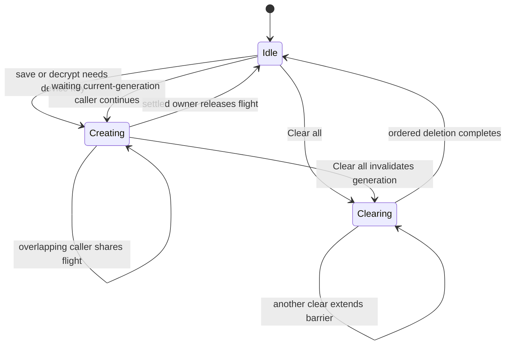
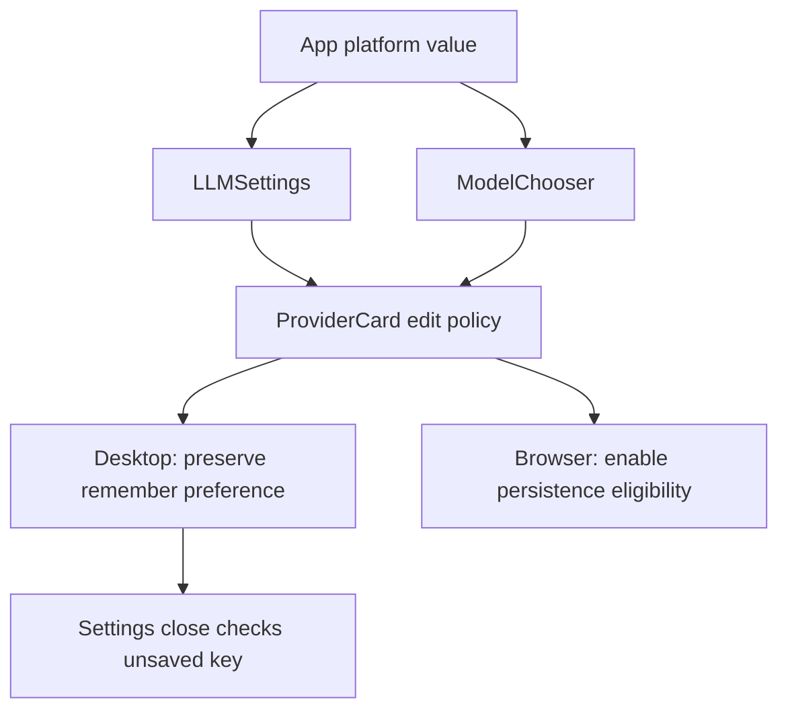

# FM-6 passwordless key integration and gate repairs - Plan

## Goal Capsule

- **Objective:** Browser users can save keys after Clear all and recover them on their next visit; desktop users retain the unsaved-key warning when they edit through either key-entry surface.
- **Means:** Preserve PR #17's complete changes, coordinate device-key creation, and propagate desktop mode through ModelChooser (KTD1–KTD3).
- **Authority:** The controller's `fm-6` mandate and supplied standing lane rules govern this item. The canonical campaign source is `docs/plans/2026-10-26-0705-feat-codex-drawdown-campaign-plan.md` in the chief repository, scoped to its Goal Capsule and R11, R15, R16, R17, R19 and R20. That source is absent from this clone; its contents have not been independently verified. The controller must supply or reconcile those excerpts before build handoff. Repository context comes from `docs/handoffs/2026-08-06-codex-transition.md` and `.planning/ROADMAP.md`; neither settles the reserved exemplar choice.
- **Execution profile:** One item, one branch (`drawdown/fm-6`), one replacement PR. This stage commits only the plan. The later build stage invokes `lfg` on this plan and completes implementation, simplification, review and local commits. The controller scans, pushes and opens the PR; the campaign gate reviews and merges it under supplied campaign R15/R19.
- **Stop conditions:** If the specified PR commit becomes unavailable, report it under `Needs your decision` and do not substitute a plan-only delivery. Respect R7's safety boundaries and report unmet verification honestly. The source-reconciliation and runtime prerequisites below belong to the controller, not a new product decision for Damien.

---

## Product Contract

### Summary

Integrate PR #17's source, tests and evidence onto the assigned current-main snapshot. Repair the concurrent creation of browser encryption keys and the missing desktop flag in the input-screen chooser. Supply deterministic regression proof and fresh full-suite acceptance for a replacement PR that supersedes #17 and #15.

### Problem Frame

PR #17 contains browser acceptance and an earlier desktop warning repair, but two gate findings remain. Concurrent browser saves can encrypt with different device keys, leaving persisted ciphertext unreadable after restart. Desktop edits through ModelChooser can reset the preference that controls the unsaved-key warning. Passing Settings-only tests does not establish the chooser's behavior.

### Requirements

**Integration and preservation**

- R1. The finished branch must carry the source and test changes from `fff81f0508524830b48f487ffe1c62b741a761fa` plus the two gate repairs relative to the assigned main snapshot. Source: mandate `fm-6`.
- R2. Preserve every existing test and assertion, existing browser persistence behavior and the current regulatory exemplar. Source: mandate `fm-6`; supplied campaign R15/R16.

**Persistence and desktop behavior**

- R3. Overlapping saves in one app instance must use a compatible persisted device key, including explicit saving of an unchanged, revalidated key after Clear all and concurrent providers. Successful payloads remain decryptable after reload and browser restart. Source: P0 gate finding.
- R4. Clear all must invalidate obsolete creation and save work without preventing a later intentional save; rejected persistence must remain session-only and allow a subsequent attempt. Preserve the existing non-extractable AES-GCM key and ciphertext formats. Source: P0 fix's existing lifecycle contract and inherited removal regressions.
- R5. After desktop Forget or Clear all, editing through ModelChooser must preserve the unsaved-key warning on Save & Close and make no automatic keychain write. Browser edits keep their existing automatic persistence eligibility. Source: P1 gate finding and retained PR #17 behavior.

**Acceptance and delivery**

- R6. Add a regression for each gate finding, pass the full frontend, API and browser suites, and commit freshly inspected Playwright screenshots under `docs/plans/evidence/fm-6/`. Source: mandate `fm-6`; supplied campaign R15/R16.
- R7. Use synthetic credentials and offline acceptance routes; do not read prohibited credential files, change security settings, spend, send messages, force-push or delete unbacked data. No schema migration, data rewrite, package release or new outside service is authorized by this item. Source: supplied campaign R11/R15/R16 and lane hard stops.
- R8. Commit locally on `drawdown/fm-6`; do not add a remote or seek credentials. The controller owns publication and campaign Astra/Fable reviews, and the replacement PR and final build handoff must explicitly supersede #17 and #15. Source: supplied campaign R15/R17/R19/R20 and mandate `fm-6`.

### Acceptance Examples

- AE1. Covers R3–R4: after Clear all, the browser retains the in-memory key. Revalidating it does not resave it. Choosing Save (encrypted) starts overlapping save requests; completing encryption in adverse order still yields the same key after a full browser restart and successful validation.
- AE2. Covers R4: clear while creation is suspended, start a new save before deletion finishes, then release obsolete work. Only the new generation can persist, and its key remains usable on the next visit.
- AE3. Covers R5: a desktop user removes a saved key in Settings, closes Settings, edits through the input-screen Online chooser, then reopens Settings. Save & Close displays “Your API key isn't saved”; the keychain ledger contains no implicit save.

### Scope Boundaries

This item includes PR #17's inherited harness, application corrections, tests and historical evidence. New work is limited to the two gate findings and their proof. Regulatory selection, CI expansion, dependency upgrades, settings redesign, warning-policy redesign and native keychain implementation changes are outside this item.

A cross-tab locking protocol is considered and not built: the reported race is between callers sharing one module instance. Coordinating independent browser contexts would require its own established contract and reproduction. This plan makes no new cross-tab guarantee. Removing one App save trigger alone is also insufficient because multiple providers can still create the same shared device key concurrently.

---

## Planning Contract

### Verified Starting State

Static inspection on 2026-11-11 established these facts. No tests, builds, installations, browser launches or cherry-picks ran during planning.

| Surface | Observed state | Planning consequence |
| --- | --- | --- |
| Assigned branch | Clean `drawdown/fm-6` at `1e3a397eff31ae1bc7969f6e22b914daddc99b28` | Preserve this starting commit and the plan commit. |
| Local refs | Local `main` is `af4a7649`; no remote exists | The local `main` label is stale. Use the assigned starting SHA for local integration evidence; the controller verifies live main before publishing. |
| PR head | `fff81f0508524830b48f487ffe1c62b741a761fa` exists as a commit | The mandate's missing-commit stop does not apply. |
| Integration range | Merge-base of the starting tip and PR head equals `1e3a397e`; the PR-only range has 12 commits, from `8a04fa48` through `fff81f05` | Bring in the entire range. No content conflicts are expected against this snapshot, but recheck at build time. |
| PR diff | 28 paths, including App, device-key, ProviderCard, the Playwright harness, manifests, lockfile, tests and evidence; no deleted paths | Verify full preservation, not just the two new corrections. |
| Instructions | No repository `AGENTS.md` or `CLAUDE.md` is present | Use the supplied lane instructions and current repository plans. |

The transition handoff describes older dependency pins and test results. The actual manifests, locks and source at the integration revision take precedence for execution. Prior receipts under `docs/plans/evidence/fm-2/` and `docs/plans/evidence/fm-5/` are historical, not current acceptance.

### Behavior Trace

At the PR head, `apps/web/src/App.tsx` calls `persistKeyToVault` directly from `handleRememberKey(true)` and indirectly from the configuration effect. Both calls can pass the same provider-generation, key-value, remember and validation checks. `packages/core/src/llm/key-vault.ts` requests a device key for each encryption. `packages/core/src/llm/device-key.ts` independently reads, generates and unconditionally stores a key for each caller, so concurrent first-use operations can return different keys. The existing generation counter cancels creation after Clear all; it does not combine concurrent creation.

`LLMSettings.tsx` already forwards `isDesktop` to ProviderCard. `packages/ui/src/components/input/ModelChooser.tsx` neither accepts nor forwards it, and App does not supply it. PR #17's ProviderCard therefore applies browser edit behavior when entered through the chooser. Existing desktop browser cases edit only inside Settings and miss this path.

### Key Technical Decisions

- KTD1. **Replay the complete PR range onto the assigned branch.** Preserve the plan commit and use the mandate's merge-base-to-PR-head cherry-pick range in order. Resolve any overlap using the current base plus the PR's behavior; do not reset to stale local `main`, skip source commits or copy only receipts. This implements R1/R8.
- KTD2. **Coordinate creation at the shared device-key boundary.** Maintain one short-lived creation promise per module generation, shared across providers and installed before asynchronous work begins. Calls after Clear all begins must wait for its deletion barrier before reading or creating. Invalidate obsolete work on clear, recheck generation before returning or committing a key, and release settled flights only if they still own the slot. Repeated clears retain deletion ordering. Do not retain an indefinitely resolved CryptoKey cache. This implements R3–R4 while keeping existing transaction-completion and abort handling.
- KTD3. **Pass desktop mode through the existing component chain.** Add an optional `isDesktop` prop to ModelChooser, supply App's existing value and forward it to every nested ProviderCard. Preserve the inherited browser default when omitted and the fm-5 editor guard. No warning-predicate or default-preference change is needed for R5.
- KTD4. **Prove the actual triggering paths before accepting fixes.** Reuse real WebCrypto, fake IndexedDB unit tests and the offline persistent-profile Playwright harness. Use explicit gates and counters, not sleep-based races; assertions must allow the fixed implementation to create only one key. The browser regression must save unchanged plaintext after revalidation, since replacement-only coverage activates a different App guard. This implements R3–R6.
- KTD5. **Keep review ownership established by the campaign.** Local work uses Astra; cloud build stages use the default Sol model and still receive controller-owned Astra/Fable reviews. (session-settled: user-directed — chosen over the Sol-first local ladder and forcing Astra for cloud builds: campaign execution roles are fixed.) Applies to R8; local plan review does not replace the campaign gate.

### High-Level Technical Design

Creation and clear lifecycle under KTD2:



Save coordination and durable success:

```mermaid
sequenceDiagram
    participant Explicit as Explicit save
    participant Effect as Auto-save effect
    participant Device as Device-key coordinator
    participant Store as IndexedDB
    Explicit->>Device: request current-generation key
    Effect->>Device: request same shared key
    Device->>Store: wait for clear, read or create
    Store-->>Device: transaction commits
    Device-->>Explicit: persisted key
    Device-->>Effect: same persisted key
    Note over Explicit,Effect: Encryptions may finish in either order; App retains its stale-save checks
```

Desktop context and the two entry surfaces under KTD3:



### Assumptions and Execution Prerequisites

- The controller-designated start SHA is the intended current-main snapshot. Live upstream state cannot be verified in this clone. Reconcile the canonical campaign excerpts and current main without giving this lane a remote or credentials.
- Existing storage names, payload shapes and public crypto helpers remain compatible. KTD2 changes coordination, not encryption policy or data formats.
- Dependency caches and browser launch capability are execution-time checks. Use the existing locks and supplied caches. Unix-socket denial may prevent Chromium from starting; record the exact failure and have the controller run the same acceptance in its permitted runtime. An unexecuted browser gate is not a pass.
- Desktop acceptance uses Chromium with a synthetic preload/keychain boundary. It does not claim native Electron packaging or OS keychain acceptance.

### System-Wide Impact

All browser providers share the same device key, so coordination must be module-wide rather than provider-specific. App's per-provider invalidation, current-key, validation and remember checks remain necessary after the device fix. Clear all remains asynchronous from the UI's perspective; the core coordinator owns deletion ordering. Unit tests prove lifecycle behavior, while native browser restart proves storage compatibility and the cross-screen test proves App's prop wiring.

---

## Implementation Units

### U1. Integrate the complete PR #17 history

**Goal:** Establish the inherited feature and test baseline on the assigned current-main snapshot.

**Requirements:** R1–R2, R7–R8; KTD1. **Dependencies:** Confirm the supplied PR object and controller authority excerpts.

**Files:** Restore the 28-path PR diff, including `apps/web/src/App.tsx`, `packages/core/src/llm/device-key.ts`, `packages/core/src/llm/device-key.test.ts`, `packages/ui/src/components/settings/ProviderCard.tsx`, `packages/ui/src/components/settings/ProviderCard.test.tsx`, `tests/browser/`, `playwright.config.ts`, `package.json`, `pnpm-lock.yaml`, `.gitignore`, `README.md`, the fm-2/fm-5 plans and their evidence directories.

**Approach:** Recheck ancestry and the clean working tree, then apply all 12 commits in their original order using KTD1. Compare the integrated source/test tree with the supplied PR head, allowing the new plan and any justified current-main conflict resolution. Preserve inherited dependency changes without adding upgrades.

**Test scenarios:**

1. The integrated diff against the recorded base contains the PR's runtime changes, ProviderCard regressions, device-key cancellation tests and every browser harness/spec file.
2. All original test assertions and evidence survive integration, and no exemplar content changes.

**Verification:** Record the integrated revision and preservation check before the gate repairs. This is integration verification; historical test results do not certify this tree.

### U2. Make device-key creation safe under overlapping saves and clears

**Goal:** Keep newly saved browser keys decryptable despite concurrent requests and late completions.

**Requirements:** R2–R4, R6–R7; AE1–AE2; KTD2/KTD4. **Dependencies:** U1.

**Files:** Modify `packages/core/src/llm/device-key.ts`, `packages/core/src/llm/device-key.test.ts`, `packages/core/src/llm/key-vault.test.ts` and `tests/browser/passwordless-key-persistence.spec.ts`. Reuse `tests/browser/helpers/key-vault.ts` and `tests/browser/fixtures/browser.ts`. Preserve the inherited safeguards in `apps/web/src/App.tsx`.

**Approach:** Implement KTD2 at the existing core boundary. Preserve native transaction commit/abort behavior and App's provider-level guards. Keep browser scheduling controls test-only and compatible with one generation serving many callers. The core tests catch coordinator interleavings; the browser test catches the direct callback/effect overlap in the built App.

**Execution note:** Establish failing concurrency/decryption expectations against U1 before the repair; use the inherited deferred native-crypto patterns.

**Test scenarios:**

1. Start concurrent first-use requests, both on an empty database and after clear. All returned keys can decrypt payloads made by their peers, and the key reloaded from IndexedDB decrypts every payload.
2. Concurrent encryptions for two providers remain decryptable through `decryptKeyDevice` after the shared flight settles; retain AES-GCM non-extractability, payload shape and no-plaintext assertions.
3. Covers AE2: hold old creation, begin clear and a new request, then settle old work after the new flight starts. The new request waits for deletion, obsolete work cannot persist, and its cleanup cannot erase the new flight. Cover repeated clears as well.
4. Reject generation or abort a write transaction, then retry successfully. Neither failure leaves a permanently rejected flight or reports a successful persisted key. Retain the existing abort-after-request-success regression.
5. Covers AE1: save and back up a synthetic profile, Clear all, wait for removal, then validate the unchanged in-memory key. Confirm it remains unsaved until explicit encrypted Save. Hold the overlapping saves so native generation overlaps before the fix, release encryption completions in reverse order, restart the browser, and validate the restored key. Gate callers and completions without waiting for two generations after the fix.
6. Retain every inherited Forget, pending-encryption, first-generation cancellation, replacement, recovery and resolver-precedence case.

**Verification:** The new deterministic P0 regression fails on U1 and passes after the repair. Full restart demonstrates actual decryption, not just ciphertext presence or a saved badge.

### U3. Preserve desktop intent through ModelChooser

**Goal:** Keep the unsaved-key warning reachable after edits on the input screen.

**Requirements:** R2, R5–R7; AE3; KTD3/KTD4. **Dependencies:** U1; U2 is required before full acceptance.

**Files:** Modify `apps/web/src/App.tsx` and `packages/ui/src/components/input/ModelChooser.tsx`; add `packages/ui/src/components/input/ModelChooser.test.tsx`; extend `tests/browser/passwordless-key-desktop.spec.ts`. Keep `packages/ui/src/components/settings/ProviderCard.test.tsx` intact.

**Approach:** Apply KTD3. Follow the inherited stateful ProviderCard test wrapper with a real nested card. Browser locators must distinguish the chooser's outer container from the nested card and the Settings dialog. Use the existing synthetic keychain ledger to establish when persistence actually happens.

**Execution note:** Show the chooser-specific failure before fixing the prop chain. Settings-only and ProviderCard-only tests cannot prove App supplies the flag.

**Test scenarios:**

1. In the real ModelChooser, a desktop edit preserves false and true remember preferences while updating the key and resetting validation. Explicit browser mode and an omitted platform prop retain browser eligibility.
2. Covers AE3: for both Forget and Clear all, remove through desktop Settings, leave the dialog, choose Online and enter a replacement through ModelChooser. Reopen Settings and choose Save & Close. Cross validation in the chooser with validation during Save & Close; require the warning and no automatic keychain write in every case.
3. Close without saving leaves the replacement absent after restart. The existing explicit warning save action writes the replacement and restores it through the synthetic keychain.
4. The inherited Settings-entry matrix and browser replacement persistence still pass, including browser default behavior through the chooser.

**Verification:** The new tests fail when either App-to-ModelChooser or ModelChooser-to-ProviderCard forwarding is absent, then pass with the complete chain. No test assertion is removed or weakened.

### U4. Record current acceptance and the replacement PR handoff

**Goal:** Give the controller evidence to publish and merge the complete repair.

**Requirements:** R1–R2, R6–R8; KTD4/KTD5. **Dependencies:** U1–U3.

**Files:** Add `docs/plans/evidence/fm-6/acceptance.md`, `docs/plans/evidence/fm-6/browser-explicit-save-restored.png` and `docs/plans/evidence/fm-6/desktop-model-chooser-unsaved-warning.png`.

**Approach:** Use the inherited masked screenshot attachments and copy selected current-run images into the fm-6 directory. Do not enable the helper's fm-2 export switch or overwrite historical evidence. Record tested revisions, commands, observed totals, skip reasons, failing-before/passing-after proof and review disposition. Inspect both screenshots and label the desktop result as simulation.

**Test expectation:** No additional runtime behavior in this documentation unit; the Verification Contract supplies acceptance.

**Verification:** Receipts match actual output, required suites pass, and the final build handoff names both screenshot paths and says the new PR supersedes #17 and #15. A blocked gate remains explicitly unpassed.

---

## Verification Contract

Run these checks in the build stage against the integrated and repaired revision. Use the committed locks and existing test settings; do not weaken tests, add retries or reinterpret an inability to launch as success.

| Check | Repository entry point | Required outcome |
| --- | --- | --- |
| P0 core regression | `pnpm --filter @folio-mapper/core test src/llm/device-key.test.ts src/llm/key-vault.test.ts` | Concurrent payloads decrypt with persisted state; clear/failure lifecycle cases pass. |
| P1 component regression | `pnpm --filter @folio-mapper/ui test src/components/settings/ProviderCard.test.tsx src/components/input/ModelChooser.test.tsx` | Both entry policies are covered without losing inherited assertions. |
| Full frontend suite | `pnpm test` | All core, UI and web tests execute and pass. |
| Browser type check | `pnpm typecheck:browser` | Existing and added browser fixtures/specs compile. |
| Production browser acceptance | `pnpm test:browser` | Fresh build and every inherited/new Playwright case pass with one worker and zero retries. |
| Full API suite | `pnpm test:api` | Every backend test runs with only established, explained optional skips. |
| Visual evidence | U4's two PNG paths | Actual restored browser key state and chooser-triggered desktop warning are visible and masked. |
| Integration and review | Diff against recorded base; full replacement PR diff at controller | Preserved PR source/tests, focused fixes, no exemplar change, no unresolved in-scope P0/P1. |

The existing CI does not run Playwright or browser typechecking, so green CI alone cannot satisfy R6. Historical fm-5 evidence reports lint and broad TypeScript problems; verify any encountered failure against the applicable baseline instead of treating that receipt as a current waiver. A Vite build is not a whole-repository typecheck. Record environmental failures separately from test failures, with the exact rerun gate for the controller.

---

## Definition of Done

This plan stage ends with the reviewed plan committed locally on `drawdown/fm-6`, with no implementation or runtime-verification claim.

The later build is complete only when U1–U4 and R1–R8 are satisfied: the branch contains PR #17's source and tests, both defects have failing-before/passing-after proof, required suites pass, fresh masked screenshots are committed, and review has no unresolved in-scope finding. Remove abandoned experimental code from the proposed diff while preserving R7's backup rule. The controller's new PR must supersede #17 and #15 and pass the campaign review/merge gate before this item is described as landed. A plan-only or receipt-only branch is not a completed build.
