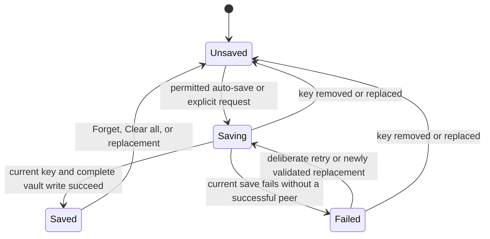
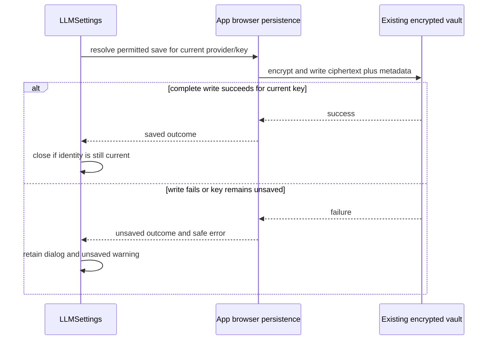

# FM-7 truthful encrypted key saves and PR 18 integration - Plan

## Goal Capsule

- **Objective:** Users see when saving an API key fails and keep the unsaved-key warning until their key is actually saved.
- **Means:** Integrate PR #18, separate save intent from successful persistence, and prove failure and retry behavior through the existing offline acceptance harness (KTD1–KTD5).
- **Authority:** The supplied `fm-7` mandate and standing lane rules govern this item. The chief repository's `docs/plans/2026-10-26-0705-feat-codex-drawdown-campaign-plan.md`, limited to its Goal Capsule and campaign R11, R15, R16, R17, R19 and R20, remains the canonical campaign authority. Campaign IDs are separate from this plan's local requirements.
- **Source prerequisite:** The chief plan and `ops/drawdown/mandates/_common.md` are unavailable in this clone and were not read. The controller must supply or reconcile those exact excerpts before build execution. The rules below derive from the supplied mandate, not an inferred campaign capsule.
- **Execution profile:** One item, `drawdown/fm-7`, one replacement PR. This stage commits only this plan. The later build stage runs `lfg` on it, including implementation, simplification, review, verification and local commits. Publication belongs to the controller and merging to the campaign gate under R10.
- **Stop conditions:** If the required PR commit is missing at build time, stop and report the missing commit under `Needs your decision`; a plan or receipt alone cannot fulfill the build. Unmet source and runtime prerequisites remain explicit controller obligations.

---

## Product Contract

### Summary

Integrate PR #18's source and tests onto the assigned base. Make failed encrypted saves visible and preserve the unsaved-key warning, while retaining successful browser persistence and desktop keychain behavior. The replacement PR supersedes #18, #17 and #15.

### Problem Frame

After Forget, PR #18 sets `rememberKey` before encryption and vault storage finish. The settings close check treats that preference as proof that the key will persist. A storage exception therefore leaves a usable key only in memory, logs the failure, and lets Save & Close dismiss the dialog without warning. Refresh can then lose the key.

### Requirements

**Integration and preservation**

- R1. The completed branch must contain PR head `3894f2987fcf2d5d6579660623b3b9d54b6d5939`'s source and test changes plus this gate repair, preserving the assigned base's behavior. Source: mandate `fm-7`.
- R2. Retain every existing test and assertion, the earlier device-key concurrency and desktop ModelChooser fixes, and the existing regulatory exemplar. Source: mandate `fm-7`; supplied campaign R15/R16.

**Truthful save behavior**

- R3. Save intent, pending work and failed work must not count as successful persistence; report the current browser key saved only after its complete encrypted vault write succeeds. Source: Astra P1 and `fm-7`.
- R4. A failed explicit save after Forget or Clear all must leave the current key usable in memory, show a safe user-visible failure, and keep Save & Close open with the unsaved-key warning. Source: Astra P1 and `fm-7`.
- R5. Successful automatic and explicit saves must retain existing close, reload and browser-restart behavior; an explicit retry after failure can save the unchanged key. Source: preservation requirement and the existing passwordless persistence contract.
- R6. Removal or replacement of a key must invalidate obsolete save outcomes, and browser changes must preserve desktop's unsaved-key warning and explicit keychain writes. Source: inherited PR #18 regressions.

**Acceptance and delivery**

- R7. Add a regression that forces a vault write to throw, proves the key is not reported saved, and proves the warning still fires; the full frontend, API and browser suites must pass. Source: `fm-7` acceptance.
- R8. Commit fresh Playwright screenshots of the changed failure/warning and recovered states under `docs/plans/evidence/fm-7/`, and name each committed path with a `SCREENSHOT:` marker in the final build handoff. Source: supplied campaign R15/R16.
- R9. Use synthetic credentials and offline fixtures; no prohibited secret-file reads, spend, sends, security changes, force-push or unbacked deletion are authorized. Add no schema migration, data rewrite, package release or outside service. Source: supplied campaign R11/R15/R16 and lane hard stops.
- R10. Commit locally on `drawdown/fm-7` without adding a remote or seeking credentials. The controller scans, pushes and opens the replacement PR, whose description and build handoff must say it supersedes #18, #17 and #15; campaign review and merge remain controller/gate responsibilities. Source: supplied campaign R15/R17/R19/R20.

### Acceptance Examples

- AE1. Covers R3–R4, R7: save a synthetic key, back up the test profile, Forget it, and revalidate the unchanged in-memory key. Make the vault payload write throw `QuotaExceededError`, then choose Save (encrypted). The input and valid connection remain, an error is visible, no saved badge appears, and Save & Close shows “Your API key isn't saved.” The failed payload write cannot restore that key on reload.
- AE2. Covers R3–R5: repeat AE1 after Clear all, then remove the injected fault without navigation and retry the same key. Successful storage clears the error, shows saved status, permits closing, and restores the same key after browser restart and revalidation.
- AE3. Covers R2–R3, R5: fresh-key Save & Close waits for successful automatic persistence and closes. While encryption is deferred it must not claim success; rejection leaves the dialog open with the failure and warning.
- AE4. Covers R2, R6: the inherited test that completes two explicit-save/effect encryptions in adverse order after Clear all still passes unchanged, as do desktop warnings after Forget/Clear all through Settings and ModelChooser.

### Scope Boundaries

New work addresses the reported persistence failure and its interaction with the existing entry points. The imported PR includes its historical plans, harness and evidence; historical evidence does not count as current acceptance.

Regulatory selection, general settings redesign, keychain failure redesign, connection-validation redesign, CI expansion and dependency upgrades are outside this item. Cross-tab locking and automatic retry/backoff are considered and not built: this repair concerns the existing app-instance save flow, and explicit retry supplies recovery without introducing repeated storage attempts.

The vault currently writes ciphertext and provider metadata separately. A metadata failure can leave ciphertext behind; this plan does not promise atomic rollback or an empty vault after every exception. R3 still requires both writes to finish before reporting success. A new storage format, rollback system or orphan-cleanup mechanism would exceed this item's scope.

---

## Planning Contract

### Verified Starting State

Static inspection on 2026-11-13 established the following. No tests, builds, installs, browser/server launches or cherry-picks ran during planning.

| Surface | Observed state | Consequence |
| --- | --- | --- |
| Assigned branch | Clean `drawdown/fm-7` at `1e3a397eff31ae1bc7969f6e22b914daddc99b28` | Preserve this base and the plan commit. |
| Local main | `af4a764922fe1f6fb05d47ae27b54d48faaee465` | It is older than the assigned base; do not reset to it. |
| Remote | None configured | Publication and live-main reconciliation belong to the controller. |
| PR head | `3894f2987fcf2d5d6579660623b3b9d54b6d5939` exists as a commit | The mandate's missing-commit stop does not apply now. |
| Integration range | Merge-base with the assigned tip is `1e3a397e`; 17 commits run from `61e06b0b` through `3894f298` | Import the whole range, including source and tests. |
| PR delta from assigned base | 35 paths; no deleted paths | Reconcile the complete delta, not merely the final commit or receipts. |
| Local instructions | No repository or available parent `AGENTS.md`/`CLAUDE.md`; the handoff's external parent instructions are unavailable | Apply supplied instructions and record missing authority honestly. |

The transition handoff, `docs/handoffs/2026-08-06-codex-transition.md`, and `.planning/ROADMAP.md` were read. Their historical test counts and branch descriptions are not current verification. The former also warns that editable Python installs can hide dependency drift; use the declared/locked environment for the API suite without taking on `fm-3`.

### Behavior Trace

At the PR head, `apps/web/src/App.tsx` starts persistence directly from `handleRememberKey(true)` and indirectly from the configurations effect. Both can encrypt the same validated manual key. `persistKeyToVault` checks provider generation, key value, preference and validation before calling `storeEncryptedKey`; its catch only logs.

`packages/core/src/llm/key-vault.ts` writes ciphertext and then metadata synchronously. Successful encryption alone proves neither write. `apps/web/src/store/llm-store.ts` persists `rememberKey` as a preference and removes plaintext/key-source values from persisted configs. `LLMSettings.hasUnsavedKey` nevertheless requires `!rememberKey`, allowing intent to suppress the warning. Its asynchronous validation path also holds render-time props.

The PR already coordinates device-key creation and clearing in `packages/core/src/llm/device-key.ts`. It forwards `isDesktop` through App and ModelChooser, preserving ProviderCard's browser-only preference reset. Retain both repairs.

### Key Technical Decisions

- KTD1. **Replay the whole PR range on the assigned branch.** Use the mandate's merge-base-to-head cherry-pick range, resolve overlaps as current base plus PR intent, and retain the plan commit. Compare the result against the assigned starting SHA as well as local `main`; the controller must verify the actual target-main diff before publication. Implements R1/R10.
- KTD2. **Keep preference and persistence evidence separate.** Preserve `rememberKey` as intent/automatic-save eligibility, including browser edit behavior. Use the current key's successful `keySource: saved` transition as browser persistence evidence, with transient pending/error state outside persisted config. A true preference never suppresses the browser unsaved warning. Implements R2–R4 without a persisted-schema change.
- KTD3. **Own asynchronous save outcomes at the application boundary.** Extract only the browser save orchestration into `apps/web/src/hooks/useBrowserKeyPersistence.ts` so it can be tested with deferred operations and the real LLM store. Keep the existing direct/effect overlap and core device-key coordinator. Capture provider, key identity and removal generation for each outcome; current success wins over a late duplicate failure. Fence obsolete success and failure after edit/removal, and gate repeated automatic attempts after a failed key lifecycle. Explicit retry remains available. Implements R3–R6.
- KTD4. **Make Save & Close await the permitted save outcome.** Expose an awaitable result from the App-owned persistence boundary. Both already-valid and newly-validated paths must evaluate current provider/key state after waiting. Successful opted-in saves close; failed or unsaved keys warn. A remembered preference alone cannot authorize closing, and a forgotten unchanged key must not be silently resaved. Keep desktop's existing warning predicate and explicit-dismiss actions. Implements R2–R6.
- KTD5. **Display provider-specific errors through both entry points.** Feed transient status through Settings and ModelChooser to ProviderCard, using existing error styling with an accessible alert. Preserve errors across Settings close/reopen within the app session, offer deliberate retry in Settings, and never display raw exception contents or API-key text. Distinguish storage failure from connection validity. Implements R4–R6/R9.
- KTD6. **Prove native storage behavior as well as UI policy.** Use hook/component tests for controlled promise ordering and offline persistent-profile Playwright for actual WebCrypto, storage exceptions and restart. Preserve the inherited exact-two-encryptions regression rather than removing a caller or weakening its assertions. Implements R2/R7/R8.
- KTD7. **Keep the campaign's execution and review roles.** Local work uses Astra; cloud build stages use the default Sol model and still receive Astra/Fable reviews. (session-settled: user-directed — chosen over the Sol-first local ladder and forcing Astra in cloud builds: execution roles are fixed by the campaign.) Applies to R10; document review here does not replace the merge gate.

The supplied replay command applies in the later build stage, not this planning stage:

```bash
git cherry-pick $(git merge-base HEAD 3894f2987fcf2d5d6579660623b3b9d54b6d5939)..3894f2987fcf2d5d6579660623b3b9d54b6d5939
```

### High-Level Technical Design

Browser persistence state under KTD2–KTD4:



Only current-key results can change these states. A successful duplicate does not wait for an older duplicate to finish, and that older failure cannot demote the successful result.

Save & Close crosses the existing ownership boundaries:



### Assumptions and Dependencies

- The recommended technical shape is a narrow browser-persistence hook plus optional shared-UI status/result props. Exact internal names and result representation remain implementation details.
- No credential, login, product taste decision or outside service is needed. The chief excerpts and socket-capable acceptance host are controller prerequisites, not requests for Damien's time.
- The assigned base represents the controller's integration snapshot. Live upstream drift cannot be verified in this clone.
- Error/pending state must remain transient because the persisted store spreads provider config fields. Do not add raw errors or key-bearing operation records there.
- Metadata-stage exceptions may leave partial ciphertext. Tests must distinguish failure sites and assert truthful UI without inventing a rollback guarantee.

---

## Implementation Units

### U1. Integrate the complete PR 18 change set

**Goal:** Carry the inherited source and regression coverage onto the assigned base.

**Requirements:** R1–R2, R9–R10; KTD1/KTD7. **Dependencies:** Controller reconciliation of the source prerequisite.

**Files:** Import all 35 paths in the verified PR delta. The behavior-bearing paths include `apps/web/src/App.tsx`, `packages/core/src/llm/device-key.ts`, `packages/core/src/llm/device-key.test.ts`, `packages/core/src/llm/key-vault.test.ts`, `packages/ui/src/components/settings/ProviderCard.tsx` and its test, `packages/ui/src/components/input/ModelChooser.tsx` and its test, `tests/browser/`, `playwright.config.ts`, `package.json`, `pnpm-lock.yaml`, `.gitignore`, `README.md` and the PR's plans/evidence.

**Approach:** Re-verify refs and working state, apply KTD1, then reconcile the imported file inventory and assertions against the PR tree. Preserve newer base work in conflicts.

**Patterns to follow:** The PR's existing offline harness, device-key coordinator and platform flag chain.

**Test scenarios:**

1. Existing core concurrency, rejected-generation retry, clear-generation and transaction-abort cases remain intact.
2. Existing browser reload/restart, removal, replacement and adverse-order ciphertext cases remain intact.
3. Existing ProviderCard/ModelChooser platform cases and desktop removal warnings remain intact.

**Verification:** The source/test diff against the assigned base is substantive and complete. Record inherited suite results from this build separately from historical receipts.

### U2. Separate browser save intent and observed outcomes

**Goal:** A rejected or obsolete persistence operation cannot make the current key appear saved.

**Requirements:** R2–R6; KTD2/KTD3/KTD6. **Dependencies:** U1.

**Files:** `apps/web/src/App.tsx`; new `apps/web/src/hooks/useBrowserKeyPersistence.ts` and `apps/web/src/hooks/useBrowserKeyPersistence.test.ts`. Keep the existing `packages/core/src/llm/device-key.ts` coordination contract.

**Approach:** Move the browser-specific save lifecycle behind the narrow hook, integrate the existing direct and automatic callers, and expose current status plus an awaitable outcome for U3. Keep removal invalidation wired through the same owner. Treat encryption and the complete synchronous vault write as distinct completion points.

**Patterns to follow:** `useLLMStore.getState()` for fresh state, the existing provider-generation fences, and deferred-operation tests in `device-key.test.ts`. Hook tests cover state ownership and ordering; they do not prove native browser durability.

**Execution note:** Start with rejected and deferred persistence regressions before changing orchestration.

**Test scenarios:**

1. After Forget and Clear all, both payload-write and metadata-write exceptions leave the current key manual and valid with a failure outcome.
2. Deferred encryption exposes no saved state; complete storage success alone publishes saved status.
3. Explicit retry of an unchanged key succeeds without navigation or a storage-driven connection revalidation.
4. Configuration updates after failure do not repeatedly trigger automatic saves; a new valid replacement key can save.
5. Edit/removal during pending work prevents obsolete success or failure from changing current status.
6. One provider's save cannot alter another provider's error; a late duplicate failure cannot demote successful persistence of the same current key.
7. Both inherited overlapping encryptions and the shared device-key creation/clear guarantees remain supported.

**Verification:** Focused hook and inherited core tests pass, with no new persisted state or change to the cryptographic payload format.

### U3. Keep the warning and expose save failures in the UI

**Goal:** Settings closes only on the correct current-key outcome and visibly explains a failed save.

**Requirements:** R2–R6; KTD4/KTD5. **Dependencies:** U2.

**Files:** `apps/web/src/App.tsx`; `packages/ui/src/components/settings/LLMSettings.tsx`; new `packages/ui/src/components/settings/LLMSettings.test.tsx`; `packages/ui/src/components/settings/ProviderCard.tsx` and its test; `packages/ui/src/components/input/ModelChooser.tsx` and its test.

**Approach:** Wire the awaitable browser result into both Save & Close paths, then make browser unsaved checks rely on actual saved/source state. Pass provider error/pending display through both entry points without adding a new inline persistence workflow. Keep desktop policy and explicit Cancel/Escape/Close without saving behavior.

**Patterns to follow:** The existing provider error presentation, key-source badge, and stateful shared-UI test harnesses. Component tests prove visible policy and callback behavior; U4 proves the actual App wiring.

**Test scenarios:**

1. A manual browser key with remember intent still true receives the unsaved warning after a rejected encrypted save.
2. Already-valid and newly-validated Save & Close wait for permitted persistence; success closes and failure warns without changing validity.
3. A forgotten unchanged key receives the warning without any implicit save request.
4. Save & Close during a deferred save cannot report success; changing provider/key before settlement cannot close against obsolete props.
5. Failure text is accessible, omits key/raw exception content, appears through Settings and ModelChooser, and clears on successful retry or replacement.
6. Desktop warnings after both removals still fire from both editing surfaces; environment/keychain/saved sources and empty keys retain their existing treatment.

**Verification:** New shared-UI tests and every inherited platform/warning assertion pass.

### U4. Prove the gate repair and refresh acceptance evidence

**Goal:** Native browser acceptance demonstrates failure, warning, retry and durable success.

**Requirements:** R1–R10; KTD6/KTD7. **Dependencies:** U1–U3.

**Files:** `tests/browser/passwordless-key-recovery.spec.ts`; `tests/browser/passwordless-key-persistence.spec.ts`; `tests/browser/passwordless-key-desktop.spec.ts`; `tests/browser/fixtures/browser.ts` and `tests/browser/helpers/key-vault.ts` only if fault/evidence support needs extending; `README.md`; new `docs/plans/evidence/fm-7/acceptance.md` and masked PNG captures.

**Approach:** Extend the offline harness with reversible, targeted fault injection. Keep unrelated storage available, verify each fault actually fired, and use gates/counters instead of timing sleeps. Update the passwordless-storage documentation to explain visible failure and deliberate retry.

**Patterns to follow:** Closed-profile backup before synthetic removal, persistent-profile restart, safe storage facts, offline request rejection and browser teardown in the inherited harness.

**Test scenarios:**

1. Covers AE1/AE2: each removal followed by unchanged-key explicit save with payload `QuotaExceededError` shows error, session-only state and Save & Close warning. The key remains in memory, and the failed payload is absent.
2. Covers R3/R7: metadata-write failure is also reported unsuccessful; allow the known partial ciphertext without falsely reporting complete save.
3. Covers AE2: restore native storage in the same session, retry the same key, and prove saved UI plus reload/restart restoration and validation.
4. Covers AE3: deferred and rejected saves exercise both Save & Close entry states; successful fresh automatic save still closes.
5. Covers AE4: run the unchanged exact-two-encryption test and all desktop Settings/ModelChooser regressions.
6. Existing encryption/IndexedDB failure tests still pass, and the new UI failure display does not make any external network call.

**Verification:** All required suites pass on the final source, and the acceptance receipt records commands, results, source identity, limitations and inspected screenshot paths. A screenshot demonstrates presentation; behavioral assertions establish the storage result.

---

## Verification Contract

All execution below belongs to the later build stage. No current acceptance is claimed.

| Gate | Concrete entry point | Required outcome |
| --- | --- | --- |
| Imported source | PR range and full delta from `1e3a397e`; controller comparison against actual target `main` | R1 proven without a plan-only or receipt-only build. |
| Focused regressions | New hook/settings tests; existing device-key, key-vault, ProviderCard and ModelChooser tests | U2/U3 failure, ordering and platform cases pass. |
| Full frontend | `pnpm test` | Every package and web suite passes with existing assertions retained. |
| Full API | `pnpm test:api` using the declared/locked backend environment | Entire API suite passes; record skips and any unavailable fixtures accurately. |
| Browser syntax | `pnpm typecheck:browser` after U1 | Browser suite and configuration typecheck. |
| Full browser acceptance | On the socket-capable host: `pnpm test:browser` | Production web build and all offline Chromium cases pass, including earlier P0/P1 regressions. |
| Screenshots | New masked captures under `docs/plans/evidence/fm-7/` | Failure/warning and recovered saved states are inspected and committed. |
| Source quality | `pnpm build`, focused typechecks and repository lint as applicable | No new failures; pre-existing lint/typecheck debt is evidenced separately, never called passed. |
| Reviews and delivery | Local implementation/simplification/review plus controller Astra/Fable gate | R10 ownership and supersession are explicit. |

This sandbox denies Unix sockets. Do not launch or retry Chromium here. The build may perform permitted tests and browser syntax checking; browser runtime acceptance remains pending until the controller runs `pnpm test:browser` on a capable host and returns evidence. That host must close every page, context and browser it opens.

Proposed screenshot destinations are `docs/plans/evidence/fm-7/browser-encrypted-save-failed.png` and `docs/plans/evidence/fm-7/browser-encrypted-save-retry-restored.png`. They are planned artifacts, not files created or verified in this stage. Reuse the harness's masked capture helper and verified synthetic-profile backups.

The chief excerpts block build authorization reconciliation. Host acceptance blocks the claim that R7/R8 are complete. Neither is a new product decision for Damien.

---

## Definition of Done

- U1's source/test inventory is present, and the final diff preserves the assigned base plus PR #18's intent under R1/R2.
- U2/U3 satisfy R3–R6 for rejection, pending work, retry, stale completion and both platform entry points.
- U4 supplies fresh passing full-suite evidence and inspected committed screenshots under R7/R8.
- No test or assertion is removed, skipped or weakened to obtain a pass; no abandoned experimental code remains in the final diff.
- Only `fm-7` work is delivered under R9/R10. The final build handoff states that the new PR supersedes #18, #17 and #15 and provides `SCREENSHOT:`, `BRANCH:`, `PLAN:` and `KIND: planned` markers.
- The local build is not described as merged or landed until the controller and campaign gate complete publication and integration.

### Sources

- `docs/handoffs/2026-08-06-codex-transition.md` and `.planning/ROADMAP.md`.
- PR `3894f2987fcf2d5d6579660623b3b9d54b6d5939` and its `docs/plans/2026-11-11-0102-fix-fm-6-key-persistence-integration-plan.md`.
- PR `docs/plans/evidence/fm-6/acceptance.md`, read as historical evidence only.
- The source/test paths cited in the behavior trace and units. No external research was needed to select this bounded local state-flow repair.
