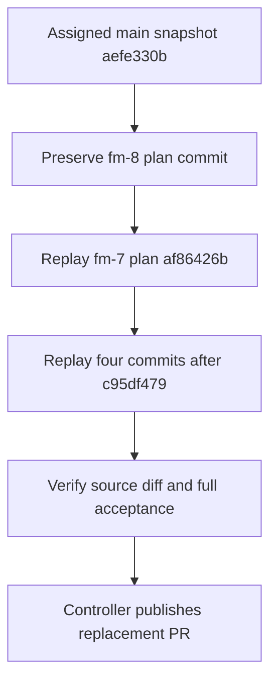
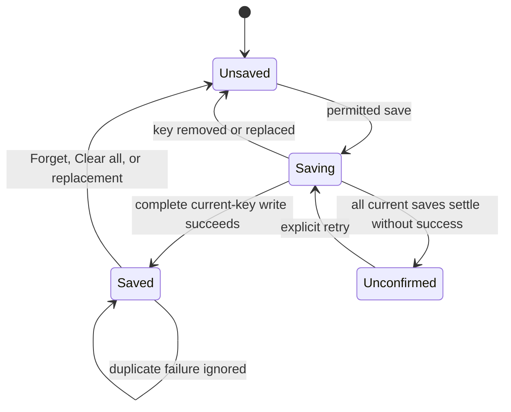

# FM-8 PR 19 integration - Plan

## Goal Capsule

- **Objective:** Users receive an accurate save-failure message and an unsaved-key warning when encrypted storage fails, with a working retry that survives a browser restart.
- **Means:** Carry PR #19's own source and tests onto the supplied main snapshot, then establish fresh acceptance for that integrated revision (KTD1–KTD3).
- **Authority:** The controller's `fm-8` mandate and supplied standing rules govern this item. The chief repository's `docs/plans/2026-10-26-0705-feat-codex-drawdown-campaign-plan.md`, limited to its Goal Capsule and campaign R11, R15, R16, R17, R19 and R20, is the canonical campaign source. Campaign IDs are distinct from this plan's R-IDs.
- **Source limitation:** The chief plan and `ops/drawdown/mandates/_common.md` are absent from this clone and were not read. The controller must reconcile those excerpts before publication; local work follows the explicit stage instruction and supplied mandate. Repository context includes `docs/handoffs/2026-08-06-codex-transition.md` and `.planning/ROADMAP.md`.
- **Execution profile:** One item, branch `drawdown/fm-8`, one replacement PR. This stage commits only this plan. The build stage runs `lfg` on it through implementation, simplification, review, verification and local commits. Publication and campaign merging follow R7.
- **Stop conditions:** If a required replay commit is missing, report it under `Needs your decision` and do not deliver a plan-only build. Browser acceptance remains incomplete until the permitted host supplies passing runtime evidence and inspected screenshots.

---

## Product Contract

### Summary

Integrate fm-7's encrypted-save failure repair and regression tests onto the supplied post-PR-18 base. Preserve the earlier concurrency and desktop warning repairs, run the full suites, and produce fresh evidence. The replacement PR supersedes #19, #17 and #15.

### Problem Frame

PR #18 merged as squash `aefe330b`, leaving PR #19's older ancestry in conflict with main. Its remaining repair prevents a failed encrypted write from masquerading as a saved key. Replaying the full ancestor chain would reintroduce work already present in the squash. The previous fm-7 receipt also leaves browser runtime acceptance and screenshots pending.

### Requirements

**Integration and preservation**

- R1. The final diff against the controller's current main must contain fm-7's source and test changes, including the failed-encrypted-save regression. Integrate `af86426b`, then `c95df479..31ebea808de089c6afbeb6ce389c44e29758b394`, preserving current-main behavior. Source: mandate `fm-8`.
- R2. Preserve every existing test and assertion, the current regulatory exemplar, and the earlier device-key concurrency and desktop warning fixes. Source: mandate `fm-8`; supplied campaign R15/R16.

**Preserved user behavior**

- R3. Report a current browser key saved only after the complete encrypted vault write succeeds. When all current save attempts settle without confirmed persistence, retain the usable in-memory key, show a safe error and unconfirmed status, and keep the Save & Close warning. An explicit retry can confirm the unchanged key; a failed duplicate cannot demote a successful save. Source: PR #19's intended repair and the `fm-7` finding carried by `fm-8`.
- R4. Preserve the imported pending-save, stale-result, partial-write and platform behavior covered by AE1–AE4 and U2. Source: PR #19's source/tests and mandate preservation requirements.

**Acceptance and delivery**

- R5. The full frontend and API suites and `pnpm test:browser` must pass on the integrated source. Historical receipts and browser typechecking do not establish current runtime acceptance. Source: mandate `fm-8`.
- R6. Generate, inspect and commit fresh Playwright screenshots under `docs/plans/evidence/`; identify their paths with `SCREENSHOT:` in the final build handoff. Source: supplied campaign R15/R16.
- R7. Commit locally on `drawdown/fm-8`; never add a remote or seek credentials. The controller scans, pushes and opens the replacement PR, whose description and build handoff state that it supersedes #19, #17 and #15. The campaign gate owns Astra/Fable review and merge. Source: supplied campaign R15/R17/R19 and mandate `fm-8`.
- R8. Follow the supplied campaign R11/R20 and lane hard stops: no prohibited credential-file reads, spend, sends in the user's voice, security changes, force-push or unbacked deletion. This item authorizes no schema migration, data rewrite, package release or new outside service.

### Acceptance Examples

- AE1. Covers R3–R4: after Forget or Clear all, revalidate the unchanged synthetic key and make its encrypted payload write throw `QuotaExceededError`. Save (encrypted) leaves the key valid in memory, shows a safe error and Save unconfirmed, and never shows Key saved. Save & Close warns. Removing the fault and explicitly retrying saves the same key and restores it after a full browser restart.
- AE2. Covers R3–R4: a metadata write fails after ciphertext was written. The UI still reports unconfirmed persistence and warns. Ciphertext, and an already-existing provider index, may remain; neither empty storage nor guaranteed loss on refresh is a universal failure requirement.
- AE3. Covers R3–R4: Save & Close during a pending save stays open for both already-valid and newly validated keys. Successful current-key persistence closes; failure warns. A changed provider, key, endpoint or model prevents an obsolete result from closing or validating the edited configuration.
- AE4. Covers R2/R4: the inherited Clear all case still handles exactly two overlapping encryptions completed newest then oldest and restores the key after restart. Desktop edits after Forget or Clear all still warn through both Settings and ModelChooser, with no implicit keychain write.

### Scope Boundaries

Work is limited to the prescribed fm-7 replay, necessary integration corrections, and acceptance evidence. Preserve the imported README, plan and historical receipt; create a separate fm-8 receipt for new results. Dependency upgrades, CI expansion, regulatory selection, storage-format changes and general settings redesign are outside this item.

Cross-tab locking, automatic retry/backoff and transactional vault rollback are considered and not built. The imported tests define the existing app-instance behavior, explicit retry and truthful reporting of partial writes. Only a concrete integration failure that violates R2–R4 would justify additional corrective work here.

---

## Planning Contract

### Verified Starting State

Static inspection on 2026-11-25 established the following. No tests, builds, installs, browser/server launches or cherry-picks ran during planning.

| Surface | Observed state | Consequence |
| --- | --- | --- |
| Assigned branch | Clean `drawdown/fm-8` at `aefe330bcbc86280b5de6aa4c248889d38c3c76d` | Preserve this starting snapshot and the fm-8 plan commit. |
| Local main | `af4a764922fe1f6fb05d47ae27b54d48faaee465`, an ancestor of the assigned tip | The label is stale; resetting to it would discard later main work. |
| Remotes | None configured | Live-main reconciliation and publication remain with the controller. |
| Required objects | `af86426b`, `c95df479`, and `31ebea808de089c6afbeb6ce389c44e29758b394` exist | The mandate's missing-commit stop does not apply now. |
| Replay baseline | `c95df479` differs from `aefe330b` only by fm-7's plan file | Application and test trees already match the required pre-fix baseline. |
| Remaining patch | Four commits after `c95df479`; 15 changed/added paths, no deleted paths | Replay these after the standalone fm-7 plan commit. |
| Local instructions | No repository `AGENTS.md` or `CLAUDE.md` found | Apply supplied instructions and relevant repository plans. |

The four remaining commits, in order, are `717f2ba9` (persistence repair), `2916918d` (configuration-edit review fixes), `abaa3d23` (regressions), and `31ebea80` (historical acceptance receipt). `af86426b` adds `docs/plans/2026-11-13-1210-fix-fm-7-encrypted-save-failure-plan.md`.

The imported patch changes no workflow, package manifest, lockfile, backend code, exemplar data, device-key implementation or persisted vault format. Earlier test totals in the handoff and receipts are historical evidence only.

### Key Technical Decisions

- KTD1. **Replay only fm-7's own commits.** Continue from the assigned `aefe330b` snapshot plus this plan, applying the exact sequence in R1. Do not replay the merge-base-to-PR-head ancestry used by older items. Resolve any conflict as the current base plus fm-7's intent, then compare both with the supplied base and the controller's actual target main. The tree comparison above supports this choice; no alternative implementation needs development.
- KTD2. **Preserve the supplied persistence design.** Retain the application-owned `useBrowserKeyPersistence` hook and the shared UI's status/result props. `rememberKey` expresses intent; `keySource: saved` follows successful ciphertext and metadata writes. Keep pending/errors transient and preserve generation/configuration guards, both save callers, and `isDesktop` propagation. This carries R2–R4 without a new abstraction or migration.
- KTD3. **Use existing acceptance and capture plumbing.** Run the imported regressions and use `FM7_CAPTURE_EVIDENCE=1` for the two existing masked capture destinations. Put new results in `docs/plans/evidence/fm-8/acceptance.md`. There is no FM8 capture flag, and this item needs no routing extension. Implements R5–R6.
- KTD4. **Retain campaign execution roles.** Local work uses Astra; cloud builds use the default model and still pass controller-owned Astra/Fable reviews. (session-settled: user-directed — chosen over the Sol-first local ladder and forcing a different cloud build model: campaign roles are fixed.) Applies to R7; local document or code review does not replace that gate.

### High-Level Technical Design

The integration sequence under KTD1 is deliberately separate from the older PR ancestry:

The imported browser state contract under KTD2 remains:

A late result cannot change a newer key's state. Unconfirmed describes incomplete evidence of persistence; it does not assert that storage is empty.

### Assumptions and Execution Prerequisites

- The assigned `aefe330b` tip is the controller's intended main snapshot, consistent with the mandate's squash description. Live upstream main cannot be verified here. The controller reconciles a newer target before final acceptance; the stale local `main` label must not substitute for it.
- The controller reconciles the chief excerpts before publication. Their absence does not block local replay and verification once the controller explicitly starts the build stage under the supplied mandate; no login, product choice or credential from the user is needed.
- The clone denies Unix sockets. Browser runtime work belongs on the controller's permitted host; do not launch or retry Chromium here. Dependencies and non-browser gate feasibility are build-stage checks.
- Existing test-owned synthetic profiles and verified backups are sufficient for removal flows. Desktop browser tests exercise the synthetic preload/keychain boundary, not native OS packaging.

### System-Wide Impact

The shared UI serves browser and desktop entry points, so an apparently local warning change can affect both. The core device-key coordinator remains the owner of concurrent key creation; the new hook owns browser save outcomes. Keep the vault's separate payload/metadata writes and the store's plaintext exclusion intact. The integration adds no new external dependency or service.

---

## Implementation Units

### U1. Replay the exact fm-7 change set

**Goal:** Bring PR #19's remaining work onto the supplied post-squash base.

**Requirements:** R1–R2, R7–R8; KTD1/KTD4. **Dependencies:** The controller's explicit build-stage instruction; recheck the required objects, assigned base and clean working tree.

**Files:** The fm-7 plan named above and all 15 paths in the patch:

- `apps/web/src/App.tsx` and `apps/web/src/hooks/useBrowserKeyPersistence.ts`.
- `apps/web/src/hooks/useBrowserKeyPersistence.test.ts` and `apps/web/src/hooks/useBrowserKeyPersistence.integration.test.tsx`.
- `packages/ui/src/components/settings/LLMSettings.tsx`, `LLMSettings.test.tsx`, `ProviderCard.tsx` and `KeySourceBadge.tsx` in that directory.
- `packages/ui/src/components/input/ModelChooser.tsx` and `packages/ui/src/components/input/ModelChooser.test.tsx`.
- `packages/ui/src/index.ts`.
- `tests/browser/helpers/key-vault.ts` and `tests/browser/passwordless-key-recovery.spec.ts`.
- `README.md` and `docs/plans/evidence/fm-7/acceptance.md`.

**Approach:** Apply KTD1 in order, preserving the fm-8 plan and unrelated current-base changes. Compare the resulting source/test tree with the supplied PR head and document each necessary conflict resolution. Keep imported receipts historical.

**Test scenarios:**

1. The diff from the assigned base contains the hook, App/UI wiring and added failure/integration/browser tests, not only plans or receipts.
2. Inherited core concurrency, browser persistence and desktop assertions remain unchanged; current-base files outside the 15-path patch retain their contents.

**Verification:** The complete inventory is present, and the controller's eventual main comparison satisfies R1. No test outcome is inferred from a clean replay.

### U2. Verify the imported state and warning contracts

**Goal:** Demonstrate that integration preserved the reported repair and its earlier regression protections.

**Requirements:** R2–R5, R8; AE1–AE4; KTD2. **Dependencies:** U1.

**Files:** The imported hook unit/integration tests; `packages/ui/src/components/settings/LLMSettings.test.tsx`; `packages/ui/src/components/settings/ProviderCard.test.tsx`; `packages/ui/src/components/input/ModelChooser.test.tsx`; `packages/core/src/llm/device-key.test.ts` and `packages/core/src/llm/key-vault.test.ts`. Change implementation or add a focused test only for a reproduced integration defect.

**Approach:** Use the supplied tests as the acceptance baseline. Preserve real-store/Settings integration coverage, deferred-operation controls and safe error assertions. These tests establish state ownership and UI policy; U3 establishes native browser durability and full App wiring.

**Test scenarios:**

1. Covers AE1: forced payload failure leaves the current key valid and manual, surfaces the error, prevents a saved badge and triggers the real Settings warning. Unchanged-key retry clears the failure and permits closing.
2. Covers AE2: metadata failure reports unconfirmed persistence even with ciphertext and a pre-existing provider index still present.
3. Covers AE3: both Save & Close validation paths await persistence; provider/key/endpoint/model changes invalidate obsolete results.
4. Edits, edit-away-and-back, Forget and Clear all invalidate obsolete success and failure. A late duplicate failure cannot demote successful persistence of the same current key; unrelated config updates do not create retry loops.
5. Covers AE4: shared device-key creation/clear tests and the desktop/browser remember-preference matrix remain intact. Both UI entry points receive platform and application-owned error state.
6. Error text excludes key values and raw exception content; transient statuses stay outside persisted configurations, and providers cannot overwrite each other's error state.

**Verification:** Focused regressions and full frontend/API tests pass on the integrated revision. Any corrective change receives a failing regression before repair, without weakening an existing assertion.

### U3. Complete browser acceptance and publishable evidence

**Goal:** Supply runtime proof and fresh masked screenshots for the replacement PR.

**Requirements:** R1–R8; AE1–AE4; KTD3/KTD4. **Dependencies:** U1–U2 and a socket-capable host.

**Files:** Run all `tests/browser/` specs, particularly `passwordless-key-recovery.spec.ts`, `passwordless-key-persistence.spec.ts`, `passwordless-key-desktop.spec.ts` and `passwordless-key-compatibility.spec.ts`. Reuse `tests/browser/fixtures/browser.ts` and `tests/browser/helpers/key-vault.ts`. Add `docs/plans/evidence/fm-8/acceptance.md` and the two capture files listed below.

**Approach:** Use offline provider routes and synthetic keys, preserve the fixture's verified profile backups, and run the entire browser suite with KTD3. Inspect both generated images. Record the exact tested revision, commands, results, source comparison, review outcome and remaining limitations in the new receipt; do not copy historical pass counts.

**Test scenarios:**

1. Covers AE1–AE2: all Forget/Clear all × payload/metadata failure combinations show error and warning, avoid automatic retry loops, and recover through explicit retry and profile restart.
2. Covers AE3: all already-valid/newly-validated × pending success/failure cases retain the correct close behavior.
3. Covers AE4: keep and run the exact-two-encryptions adverse-order test and both desktop editing-surface matrices unchanged.
4. Existing reload, replacement, compatibility, encryption/IndexedDB failure and narrow-viewport acceptance remains green.
5. The representative Forget × payload-failure screenshot shows the failure/warning state; its companion shows successful retry/restoration. Full-suite results, rather than these two images, prove the remaining cases.

**Verification:** R5–R7 are complete only with host runtime results, inspected committed images and a revision-specific fm-8 receipt. Close all opened pages, contexts and browsers. The controller then handles publication and campaign review.

---

## Verification Contract

All runtime checks below belong to the later build stage. Use the committed dependency locks and supplied cache; avoid editable Python installs, as the transition handoff warns. Install the Chromium revision belonging to the repository's pinned Playwright package on the permitted host.

| Gate | Entry point | Required evidence |
| --- | --- | --- |
| Source preservation | Compare final source/test delta with `aefe330b` and the prescribed PR patch; controller compares actual main | R1 and U1's inventory, with conflict resolutions explained. |
| Full frontend | `pnpm test` | All package and web Vitest suites pass. |
| Full API | `pnpm test:api` in the declared/locked backend environment | Full suite passes; enumerate existing optional skips and any new failure. |
| Browser static checks | `pnpm typecheck:browser` | Specs and configuration typecheck; not a runtime pass. |
| Production build | `pnpm build` | Integrated web app builds. The browser command also builds it. |
| Full browser and captures | On the permitted host: `FM7_CAPTURE_EVIDENCE=1 pnpm test:browser` | All browser specs pass, including failure and earlier P0/P1 cases. |
| Source quality | `git diff --check`, `pnpm lint`, `pnpm exec tsc --project apps/web/tsconfig.json --noEmit` | No new issues; attribute any baseline failures to the same toolchain and base. |
| Review and delivery | Local `lfg` review plus controller Astra/Fable gate | R7 fulfilled; no plan-only or receipt-only build. |

The historical fm-7 receipt reports missing ESLint flat configuration and existing app TypeScript errors. Recheck during build and distinguish evidenced baseline debt from new failures; do not claim those gates passed or expand fm-8 into unrelated repairs. A required test-suite failure still blocks acceptance.

The exact host browser setup command is `pnpm exec playwright install chromium`, after installing dependencies from the committed lock. The acceptance command is the full `FM7_CAPTURE_EVIDENCE=1 pnpm test:browser`; test discovery or `typecheck:browser` cannot replace it. Do not attempt Chromium in this clone or retry a denied launch.

Fresh screenshot destinations already supported by the imported helper:

- `docs/plans/evidence/fm-7/browser-encrypted-save-failed.png`
- `docs/plans/evidence/fm-7/browser-encrypted-save-retry-restored.png`

Neither PNG exists in the supplied PR head. They retain the helper's fm-7 path but will be generated from the fm-8 source; the new fm-8 receipt must make that provenance explicit. Inspect masking and retain only synthetic, public-safe evidence. The final build handoff must list both actual committed paths with `SCREENSHOT:` markers.

---

## Definition of Done

- U1 preserves the supplied base and carries the complete prescribed fm-7 source/test delta; the controller confirms the substantive diff against current main.
- U2 demonstrates R2–R4 through the retained regressions, including actual vault-write exceptions and the real Settings warning.
- U3 provides passing full frontend/API/browser results and inspected fresh screenshots, tied to the tested revision under R5–R6.
- Existing tests are neither deleted, skipped nor weakened; no abandoned experimental code remains, and any cleanup respects R8's backup requirement.
- The build follows R7 and identifies the replacement PR as superseding #19, #17 and #15. Its final handoff includes the branch, this plan path, `KIND: planned` and screenshot markers.
- The lane reports local completion accurately; it does not describe the work as merged before the controller and campaign gate complete that action.

### Sources

- Controller-supplied `fm-8` mandate and standing lane rules; canonical chief paths and access limitation recorded in the Goal Capsule.
- `docs/handoffs/2026-08-06-codex-transition.md` and `.planning/ROADMAP.md`, read as historical repository context.
- `aefe330b`, `af86426b`, `c95df479` and `31ebea808de089c6afbeb6ce389c44e29758b394`, inspected locally.
- PR-head `docs/plans/2026-11-13-1210-fix-fm-7-encrypted-save-failure-plan.md` and `docs/plans/evidence/fm-7/acceptance.md`, together with the source/test paths above.
