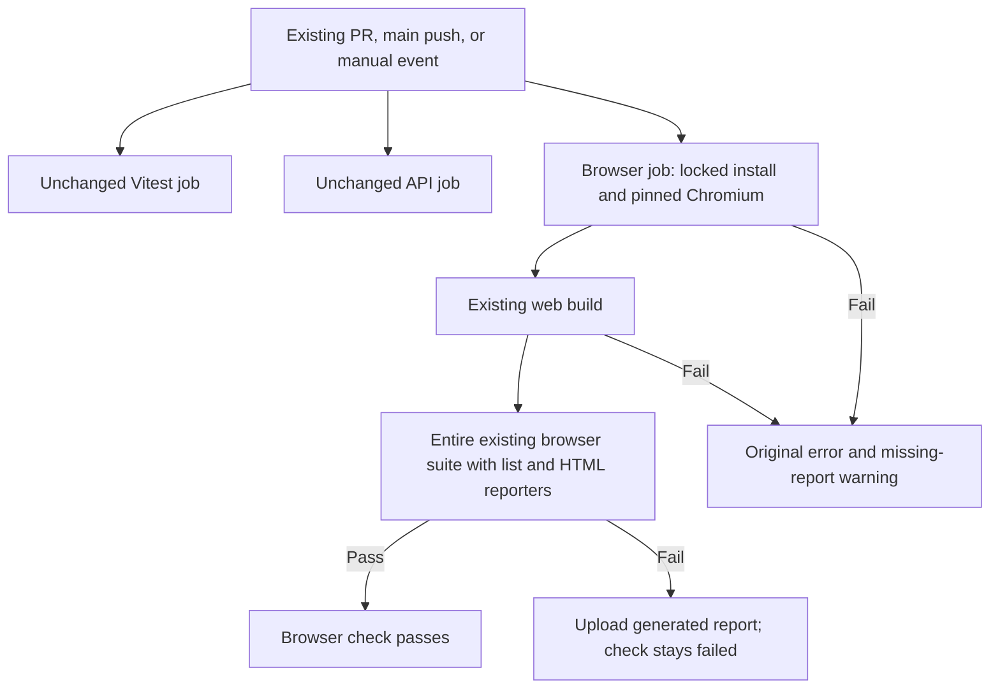

# fm-9 Browser Acceptance CI - Plan

## Goal Capsule

- **Objective:** Maintainers can detect regressions in passwordless key persistence before merging a change and inspect a report when browser acceptance fails.
- **Means:** Add an independent browser job to the existing test workflow, using the committed Playwright suite and failure-report artifacts (KTD1-KTD3).
- **Authority:** The fm-9 mandate and supplied lane rules govern this item. Upstream authority is the chief repository's `docs/plans/2026-10-26-0705-feat-codex-drawdown-campaign-plan.md`, limited to its Goal Capsule and campaign R11, R15, R16, R17, R19, and R20, plus `ops/drawdown/mandates/_common.md`.
- **Source limitation:** Those chief files are absent from this clone. Campaign references here trace to the supplied instructions, not an independent reading of the chief plan. The controller must supply or check the named sections before scheduling the build. No repository or ancestor `AGENTS.md`/`CLAUDE.md` was found; the instructions supplied with the task apply.
- **Execution profile:** This stage writes and locally commits the plan only. The build stage executes this plan on `drawdown/fm-9`; both units ship in one PR. The controller scans, pushes, opens the PR, and supplies host and hosted-run evidence; the campaign gate merges it (campaign R15, R19).
- **Stop conditions:** Apply R4-R7. Report baseline failures and scope conflicts without changing tests or undertaking another mandate item. Browser execution requires a host that permits the preview server and Chromium sockets.

---

## Product Contract

### Summary

Run the existing passwordless-key Playwright acceptance suite in the `Tests` workflow. Preserve the current frontend and API jobs and provide a downloadable HTML report for browser-test failures.

### Problem Frame

The supplied branch has acceptance coverage for encrypted persistence, browser restart, Forget, Clear all, storage failures, and simulated desktop warnings. CI runs Vitest and API tests, but never executes these browser cases. A green workflow therefore gives maintainers no evidence that the browser persistence flows still work.

### Requirements

**Browser coverage and diagnostics**

- R1. Add a browser job to `.github/workflows/ci.yml` that runs the full existing `pnpm test:browser` suite on pull requests targeting `main` and pushes to `main`; retain the existing manual trigger.
- R2. Install Chromium and its Linux dependencies through the repository's lock-pinned Playwright executable after a frozen dependency install.
- R3. A failed browser test leaves the job failed and uploads its HTML report with available attachments; setup or build failures retain their original errors when no report exists.

**Preservation and delivery**

- R4. Keep the existing Vitest and API job blocks unchanged and green, and never delete, skip, filter, weaken, or add retries to existing tests.
- R5. Leave `.github/workflows/build-desktop.yml`, application behavior, and the regulatory exemplar choice untouched; no dependency upgrade, migration, data rewrite, package release, or new outside service belongs to fm-9.
- R6. Observe the supplied hard stops: no spend, credential or security-setting changes, sends in the user's voice, unbacked deletion, force-push, secret-file access, remote creation, or login discovery (campaign R11, R15, R16).
- R7. Keep this item on `drawdown/fm-9`, commit public-safe material with repository-relative paths, and leave publication and merge to the controller and campaign gate (campaign R17, R19). Report any decision-only blocker using campaign R20's required fields.

### Acceptance Examples

- AE1. **Covers R1, R2, R4:** A PR revision passes all existing browser cases using the locked Chromium, and all three independent checks are green.
- AE2. **Covers R3:** A browser assertion fails after attaching a synthetic screenshot. The command exits nonzero, the check stays failed, and the downloaded HTML report opens with the failure and attachment intact.
- AE3. **Covers R3:** Dependency installation or the web build fails before Playwright starts. The original step fails, logs explain the failure, and the uploader warns that no report was found.

### Scope Boundaries

The intended implementation changes `.github/workflows/ci.yml`, the relevant testing paragraphs in `README.md`, and a new build evidence receipt. R4-R6 govern protected files and behavior. This is CI configuration, with no changed page requiring a committed screenshot; existing masked screenshots may be included in the generated report.

Browser matrices, sharding, retries, caches, trace instrumentation, and a report-hosting service were considered and excluded. The existing suite and GitHub artifact download meet the mandate; measured runtime or diagnostic gaps would justify a separate proposal. Other mandate items, including pending persistence repairs, remain outside fm-9.

---

## Planning Contract

### Verified Starting State

The supplied branch was clean at `aefe330bcbc86280b5de6aa4c248889d38c3c76d`, with no remote. The local `main` ref points to `af4a764922fe1f6fb05d47ae27b54d48faaee465`, fourteen commits behind this branch. It lacks the browser suite and current CI file, so it is not a suitable reset target. The controller must compare delivery against its current upstream `main` while preserving subsequent work.

| Source | Static finding | Planning consequence |
| --- | --- | --- |
| `.github/workflows/ci.yml` | Independent `vitest` and `api` jobs; PR/main/manual triggers; read-only permissions; event/ref concurrency; 20-minute job limits | Append one independent job without changing existing blocks or workflow-level settings |
| `package.json`, `pnpm-lock.yaml` | `@playwright/test` and resolved Playwright packages are `1.64.1`; browser script builds before running tests | Reuse the script and installed CLI; no manifest or lock change |
| `playwright.config.ts` | List reporter, one worker, zero retries, `forbidOnly`, strict preview port 58174, no server reuse | Select HTML reporting at invocation; preserve config |
| `tests/browser/fixtures/browser.ts` | Fresh persistent Chromium profiles, restart checks, verified profile backups, contexts closed in teardown | No personal profile, Electron installation, or extra fixture machinery |
| `tests/browser/fixtures/offline-api.ts` | Synthetic keys and API responses; unexpected network requests fail | No backend, provider account, or real credentials in the browser job |
| `tests/browser/helpers/key-vault.ts`, `.gitignore` | Masked screenshot attachments; HTML reports and profiles ignored | Upload report assets only; keep evidence-copy environment flag unset |
| `README.md` | CI section describes two jobs; browser section records a Node 24 test environment | Add the browser check and distinguish its Node 22 CI setup from historical local results |

The required handoff, `docs/handoffs/2026-08-06-codex-transition.md`, and `.planning/ROADMAP.md` were read as historical context. Their older completion and merge claims are not current acceptance evidence. The existing CI setup and verification are documented in `docs/plans/2026-10-26-1246-chore-fm4-vitest-api-ci-plan.md` and `docs/plans/evidence/fm-4-ci-verification.md`.

The unauthenticated [repository page](https://github.com/alea-institute/folio-mapper) identifies the repository as **Public**, checked on 2026-11-26. This satisfies the public-repository exception to the standing GitHub Actions rule for planning. Before publication or workflow administration, the controller must recheck visibility with its authorized repository tooling. The lane must not acquire a remote or credentials to perform that check.

### Assumptions

These technical defaults have not been runtime-verified in this stage:

- A single `ubuntu-latest` browser job with the existing 20-minute limit is sufficient for the unmodified serial suite.
- A seven-day artifact retention period is sufficient for diagnosing a failed revision and fits the repository's retention policy.
- Node 22 remains the browser job's application runtime, matching existing CI. The pinned Playwright metadata supports it; the complete suite still needs host verification on that runtime.

### Key Technical Decisions

- KTD1. **Extend the existing independent-job pattern.** Use job ID `browser` and check name `Browser (Playwright)`, with no dependency on Vitest or API. Copy the existing checkout, Node 22, and pnpm 10.34.9 setup references and inputs into the new job, retaining disabled setup caches. Inherit workflow-level triggers, permissions, and concurrency unchanged. Governs R1, R4.
- KTD2. **Use the installed Playwright for both browser installation and execution.** Install Chromium with system dependencies, then invoke the existing browser script with `--reporter=list,html` and `PLAYWRIGHT_HTML_OPEN=never`. This keeps the build-before-test path and local reporter defaults without editing configuration or scripts. pnpm documents trailing-argument forwarding, and pinned Playwright source supports the reporter selection. Governs R1, R2. [Browser installation](https://playwright.dev/docs/browsers), [pnpm 10 script arguments](https://pnpm.io/10.x/cli/run#options), [pinned CLI](https://raw.githubusercontent.com/microsoft/playwright/v1.64.1/packages/playwright/src/program.ts), [pinned Node requirement](https://raw.githubusercontent.com/microsoft/playwright/v1.64.1/packages/playwright/package.json).
- KTD3. **Upload the complete report only on failure.** Use `failure() && !cancelled()` for the upload step, a stable `playwright-report` artifact name, the entire `playwright-report/` directory, seven-day retention, and `if-no-files-found: warn`. Keep archive mode and default hidden-file exclusion. Upload success must not suppress a failed install, build, or test; do not add `continue-on-error` or shell error suppression. A canceled or killed runner cannot guarantee an artifact. Governs R3, R6. [GitHub status functions](https://docs.github.com/en/actions/reference/workflows-and-actions/expressions#status-check-functions), [upload inputs](https://github.com/actions/upload-artifact), [report attachment handling](https://raw.githubusercontent.com/microsoft/playwright/v1.64.1/packages/playwright/src/reporters/html.ts).
- KTD4. **Follow the workflow's immutable action pins.** Research found `actions/upload-artifact` v7.0.2 at `cf430e030ddbb5b0abf93d22962f4752f3646cd9`, using Node 24 internally. Recheck its release-to-SHA mapping during implementation, then pin the action with a version comment. Its runtime does not require changing application Node 22 or the existing jobs. Governs R3-R5. [Release](https://github.com/actions/upload-artifact/releases/tag/v7.0.2), [tagged action metadata](https://raw.githubusercontent.com/actions/upload-artifact/v7.0.2/action.yml).
- KTD5. **Keep campaign execution and review ownership.** Local campaign work uses Astra; cloud build stages use their default model, and the campaign gate retains Astra and Fable reviews. Governs R7. (session-settled: user-directed — chosen over the Sol-first local ladder and holding ordinary guarded changes for personal review: the campaign's supplied decisions fix those responsibilities.)

### High-Level Technical Design

KTD1-KTD3 govern the paths shown. Cancellation stops an obsolete run under the existing concurrency policy; it is not a passing result. The HTML reporter includes attachments the tests actually created, not guaranteed traces or a screenshot for every possible failure.

### Prerequisites and Risks

The chief-source check in the Goal Capsule is a controller prerequisite before build dispatch. Hosted trigger and artifact behavior require controller verification after publication; local files alone cannot prove either.

The lane's socket restrictions prohibit browser/server execution. The build agent must run available non-browser checks and leave the exact host checks below pending. It must not retry Chromium after the known sandbox failure. Browser downloads and system dependencies must be available on the host or standard GitHub runner; do not substitute system Chrome or upgrade Playwright to conceal installation failures.

An existing application failure belongs to the relevant mandate lane. Record the failing command and revision, preserve all assertions, and notify the controller rather than expanding this configuration change. Rollback is a focused revert of the new job and its documentation, preserving the two existing jobs and all application work.

---

## Implementation Units

### U1. Run browser acceptance and retain failure reports in CI

**Goal:** Give maintainers an independent browser check with usable failure diagnostics.

**Requirements:** R1-R7; AE1-AE3; KTD1-KTD5.

**Dependencies:** Controller completes the chief-source prerequisite; the existing suite and CI file remain present at the build baseline.

**Files:** Modify `.github/workflows/ci.yml`. Exercise unchanged `tests/browser/harness.spec.ts`, `tests/browser/passwordless-key-persistence.spec.ts`, `tests/browser/passwordless-key-recovery.spec.ts`, `tests/browser/passwordless-key-compatibility.spec.ts`, and `tests/browser/passwordless-key-desktop.spec.ts`. Use `playwright.config.ts`, `package.json`, and the browser fixtures as read-only references.

**Approach:** Append the job using KTD1-KTD4. Keep reporter overrides local to the browser invocation and leave `FM2_CAPTURE_EVIDENCE` unset so CI cannot rewrite historical screenshot evidence. Preserve the current test-discovery and fixture behavior under R4.

**Execution note:** This is workflow configuration; use install/runtime and failure-report proof instead of adding tests that merely mirror YAML. Existing browser specs exercise the real built app and storage, but they do not prove GitHub dispatch or artifact delivery.

**Verification scenarios:**

1. Covers AE1. From a clean prepared checkout, the browser command builds the app and runs all existing specs with the pinned Chromium. A successful run has no uploaded failure artifact.
2. Covers AE2. In a separate preserved source copy, add a temporary synthetic case that attaches a harmless artifact and fails an assertion. The same browser invocation exits nonzero and generates an HTML report containing that failure and attachment. Do not alter any existing test or commit the temporary case.
3. Covers AE3. An isolated setup/build-failure probe never reaches Playwright, retains a failed result, and exercises the uploader's documented missing-file warning rather than inventing a report. Hosted step behavior is checked by the controller.
4. The workflow validates, and structural inspection confirms all browser cases remain selectable without grep, project filters, skips, retries, or error suppression. Existing Vitest/API job blocks and the desktop workflow are byte-identical to the build baseline.
5. The controller observes PR/main dispatch and a failed browser check with a downloadable, usable report. A later passing revision has all three checks green; canceled or timed-out runs do not count as acceptance.

**Verification:** The Verification Contract distinguishes local execution, host execution, and hosted delivery. No new permanent test file is required for this configuration-only unit.

### U2. Document reproduction and acceptance evidence

**Goal:** Let contributors reproduce the browser check and let the controller identify remaining acceptance work.

**Requirements:** R1-R7; KTD2-KTD5.

**Dependencies:** U1.

**Files:** Update the CI and browser-testing paragraphs in `README.md`; create `docs/plans/evidence/fm-9-ci-verification.md` during the build stage.

**Approach:** Document the browser check, locked browser installation, CI reporter invocation, failure artifact location, and its retention. Record tested commit, actual tool versions, suite results, skip reasons, failure probes, scope comparison, and any pending host/hosted checks in the receipt. Cite results rather than copying historical pass counts.

**Test expectation:** No new automated test; verify that the documented commands match U1 and the receipt accurately distinguishes execution from inspection.

**Verification:** README instructions reproduce the job, and each claimed acceptance result names its actual evidence. Reports, profiles, backups, and caches remain uncommitted under R6-R7.

---

## Verification Contract

No tests, builds, browser launches, or dependency installs run during planning. The following commands are build-stage gates; browser/server commands require an unrestricted host. Run the full gates on the final implementation commit before publication, and reverify affected gates after review fixes.

| Check | Command or evidence | Required result |
| --- | --- | --- |
| Locked Node setup | `pnpm install --frozen-lockfile` | Installs the committed graph without lock changes |
| Browser tooling | `pnpm typecheck:browser` | Existing browser sources and configuration typecheck |
| Chromium setup, host only | `pnpm exec playwright install --with-deps chromium` | Installs the browser revision selected by locked Playwright |
| Browser acceptance, host only | `pnpm test:browser` | Entire existing suite passes, with build and preview server included |
| CI invocation, host only | `PLAYWRIGHT_HTML_OPEN=never pnpm test:browser --reporter=list,html` | Same suite runs; console output and complete HTML report are produced |
| Existing frontend suite | `pnpm test` | Core, UI, and web suites pass |
| Locked API setup, in `backend` | `uv sync --locked --extra dev --python 3.12` | Uses committed lock and dev extras |
| Existing API suite, in `backend` | `.venv/bin/python -m pytest tests/ -v -ra` | Complete suite passes with only existing optional skips, reported separately |
| Workflow syntax | `actionlint .github/workflows/ci.yml` | No syntax or expression findings |
| Diff integrity | `git diff --check` and comparison against the build baseline | Existing jobs, desktop workflow, application, tests, manifests, and locks unchanged |
| Failure path | U1 scenarios 2-3 in isolated copies | Failure status preserved; report and available attachments usable; absent report explained |
| Hosted acceptance | Controller's PR, failure-artifact, and post-merge `main` run evidence | Intended revision receives all three checks; failure artifact downloads correctly |

The two host browser invocations prove separate entry-point contracts: the documented default and the CI reporter override. Execute each once on the implementation revision, then repeat only when changes or failures warrant it. Close every browser context and preview server opened during verification. Do not remove retained profiles or backups without a verified backup.

The controller may validate an intentional hosted failure in an isolated validation branch; no failing probe belongs in the deliverable branch. Confirm successful artifact upload leaves the browser job red. If the runner terminates before reporting, record the missing artifact honestly and use the runner logs.

---

## Definition of Done

The plan-stage deliverable is this reviewed plan committed locally on `drawdown/fm-9`, without implementation or test execution.

The build handoff contains U1-U2, available local checks, and a truthful evidence receipt. Host browser verification remains pending until executed; the sandbox limitation is not a pass. The final diff contains only the intended workflow, documentation, and receipt, with no temporary probes or abandoned implementation attempts.

Campaign acceptance requires the full suites passing on the implementation commit and controller evidence for the PR/main browser job and failure-report upload. R4-R7 remain satisfied through publication and the existing campaign merge gate. No new product decision from the user is identified.
